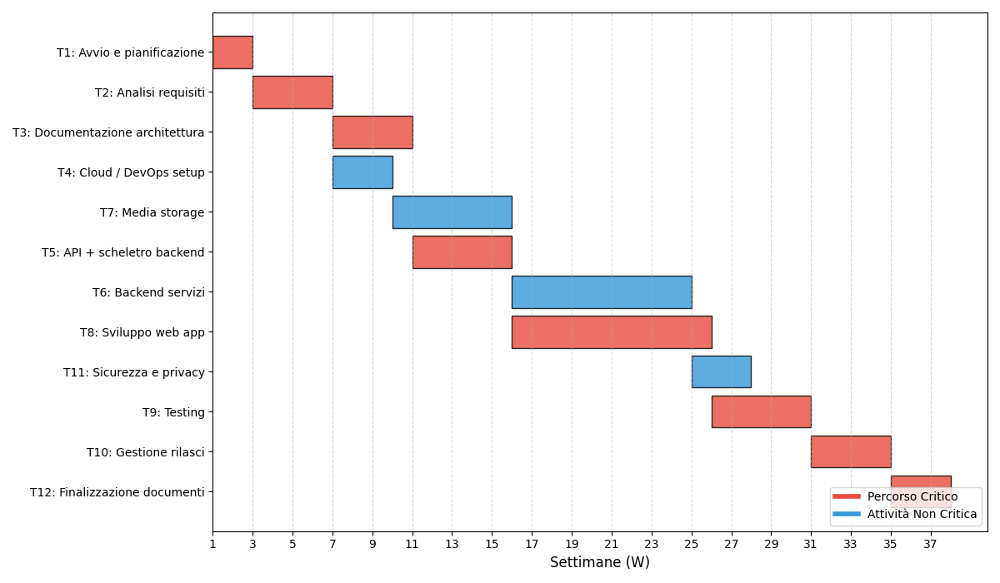

# Product Breakdown Structure (PBS)

| ID  | Deliverable                         | Type  | Notes                                                                                                                                             |
|:----|:------------------------------------|:-----|:--------------------------------------------------------------------------------------------------------------------------------------------------|
| S1  | Applicazione Web (UI + client)      | Software | Piattaforma software basata su architettura client-server                                                                                         |
| S2  | API Gateway                         | Software  | Punto di ingresso unico per il routing delle richieste verso i servizi di backend                                                                 |
| S3  | Autenticazione e servizi utente     | Software | Sistema per il log-in e registrazione                                                                                                             |
| S4  | Inserimento segnalazioni            | Software | Pagina per l'inserimento di una nuova segnalazione con associata la categoria                                                                     |
| S5  | Visualizzazione segnalazioni        | Software | Portale per la visualizzazione complessiva tramite mappa o elenco delle segnalazioni, link alla pagina di dettaglio per le singole segnalazioni   |
| S6  | Tracking stato segnalazioni         | Software | Assegna ad ogni segnalazione uno stato e lo aggiorna a seconda del suo avanzamento                                                                |
| S7  | Servizio di notifiche               | Software | Notifiche web / email per utenti che seguono una segnalazione                                                                                     |
| S8  | Messaggistica web                   | Software | Gestisce la comunicazione tra cittadini ed operatori via web                                                                                      |
| S9  | Esportazione dati                   | Software | Permette di esportare l'elenco di segnalazioni in formato csv                                                                                     |
| S10 | Statistiche                         | Software | Servizi per analisi statistiche sulle segnalazioni (pubblici / privati)                                                                           |
| S11 | Amministrazione & Moderazione       | Software | Controllo veridicità segnalazioni e verifica identità utenti                                                                                      |
| I1  | Configurazione Repository           | Infrastruttura | Repository per Version Control                                                                                                                    |
| I2  | CI CD                               | Infrastruttura | Continous Integration Continous Deployment                                                                                                        |
| I3  | Configurazione Docker e Kubernetes  | Infrastruttura | Scalabilita'                                                                                                                                      |
| I4  | Database                            | Infrastruttura | Database relazionale per persistenza dati                                                                                                         |
| I5  | Analisi Log                         | Infrastruttura | Manutenzione app                                                                                                                                  |
| I6  | Gestione Backup                     | Infrastruttura | Ripristino                                                                                                                                        |
| I7  | Server SMTP                         | Infrastruttura | Server per gestione Email                                                                                                                         |
| I8  | Account OSM                         | Infrastruttura | Account OpenStreetMap                                                                                                                             |
| I9  | Media storage                       | Infrastruttura | Sistema di archiviazione di contenuti multimediali (foto)                                                                                         |
| D1  | Documento di scopo e visione        | Documentazione | Necessità di allineamento tra requisiti e aspettative cliente                                                                                     |
| D2  | Documento dei requisiti             | Documentazione | Funzionalità e vincoli operativi del sistema                                                                                                      | 
| D3  | Documentazione APIs                 | Documentazione | Swagger                                                                                                                                           |
| D4  | Documentazione Database             | Documentazione | Struttura tabelle per gestione di utenti,geolocalizzazione e foto                                                                                 |
| D5  | Documentazione Testing              | Documentazione | Definizione piano di test, test cases e procedure di validazione per verificare correttezza e requisiti qualitativi                               |
| D6  | Privacy, termini e condizioni d'uso | Documentazione | Regole di utilizzo della piattaforma,diritti multimediali su contenuti caricatie informative sulla geolocalizzazione                              |
| D7  | Istruzioni d'uso                    | Documentazione | Manuali e guide utente per facilitare l'utilizzo del sistema                                                                                      |  
| D8  | Architettura                        | Documentazione | Definizione architettura del software e come il frontend interagisce con il server                                                                | 
| D9  | Manualistica deploy                 | Documentazione | Guida tecnica alle procedure di installazione, configurazione dell'ambiente server, setup dei container Docker e messa in produzione del sistema. | 

---

# Work Breakdown Structure (WBS)

### WBS with traceability to PBS
| ID   | Work package                     | Traced PBS outputs (IDs) |
|:-----|:---------------------------------|:-------------------------|
| WP1  | Avvio e pianificazione           | D1                       |
| WP2  | Analisi Requisiti                | D1,D2                    |
| WP3  | Documentazione Architettura      | D3,D8,S2                 |
| WP4  | Cloud/DevOps                     | I2,I3,I4,I5,I7,I8,I9     |
| WP5  | Backend                          | S2,S3,S6,S7,S10,I5,S9,S8 |
|      | 5.1  API + scheletro backend     | S2,S3,I5                 |
|      | 5.2  Backend                     | S6,S7,S10,S9,S8          |
| WP6  | Media Storage & Streaming        | I9,S4,S5,D4              |
| WP7  | Sviluppo Web App                 | S1,S4,S5                 |
| WP8  | Sviluppo Test                    | D5 D8,S1,S2              |
| WP9  | Gestione Rilasci                 | D7,D9,S1                 |
| WP10 | Sicurezza,Privacy,Aspetti Legali | S3,S11,D6,I7             |
| WP11 | Finalizzazione Documenti         | D1,D2,D3,D5,D8           |

---

# Gantt, dependencies, and critical path

Finestra temporale: 9 mesi, circa 39 settimane

## Activity table
| ID | Activity | Duration | Dependencies | Start | End | Critical | Milestone |
|:---|:-----------|:---:|:--------|:------:|:----:|:--------:|:----------|
| T1 | Avvio e pianificazione      |  2   |  -     |  W1  |  W2  |    Sì    | Sì        |
| T2 | Analisi requisiti           |  4   |  T1    |  W3  |  W6  |    Sì    | Sì        |
| T3 | Documentazione architettura |  4   |  T2    |  W7  |  W10 |    Sì    | No        |
| T4 | Cloud / DevOps setup        |  3   |  T2    |  W7  |  W9  |    No    | No        |
| T5 | API + scheletro backend     |  5   |  T3,T4 |  W11 |  W15 |    Sì    | Sì        |
| T6 | Backend servizi             |  9   |  T5    |  W16 |  W24 |    No    | No        |
| T7 | Media storage               |  6   |  T4    |  W10 |  W15 |    No    | No        |
| T8 | Sviluppo web app            |  10  |  T3,T5 |  W16 |  W25 |    Sì    | No        |
| T9 | Testing                     |  5   |  T6,T7,T8 |  W26 |  W30 |    Sì    | Sì        |
| T10| Gestione rilasci            |  4   |  T9,T11|  W31 |  W34 |    Sì    | No        |
| T11| Sicurezza e privacy         |  3   |  T6    |  W25 |  W27 |    No    | No        |
| T12| Finalizzazione documenti    |  3   |  T10   |  W35 |  W37 |    Sì    | Sì        |

## Critical path
`T1 → T2 → T3 → T5 → T8 → T9 → T10 → T12`

## Gantt Diagram

---

# Risk Management

**Scales and thresholds**
- **Probability (P)**: 1 (rare) … 5 (almost certain)
- **Impact (I)**: 1 (minor) … 5 (critical)
- **Exposure**: `P × I` (range 1–25)

Risk level thresholds (by exposure):
- **Low**: 1–5
- **Medium**: 6–10
- **High**: 11–16
- **Very High**: >16

## Risks table
| ID  | Risk                                                              | Category            | P | I | P×I | Level      | Mitigation / Response strategy                                  |
|:----|:------------------------------------------------------------------|:--------------------|--:|--:|----:|:-----------|:----------------------------------------------------------------|
| R1  | Utilizzo di linguaggio e contenuti inappropriati                  | Sociale / Legale    | 2 | 4 |   8 | Medio      | Moderazione, filtri basati su blacklist                         |
| R2  | Indisponibilità di servizi esterni (OpenStreetMap)                | Tecnico             | 2 | 5 |  10 | Medio      | Caching dei dati                                                |
| R3  | Inconsistenza della UI su dispositivi mobile (responsive failure) | Tecnico             | 3 | 4 |  12 | Alto       | UI adattiva, facilitazione input                                |
| R4  | Vulnerabilità e data breach                                       | Sicurezza / Privacy | 2 | 5 |  10 | Medio      | Test, log, incident response                                    |
| R5  | Abuso del servizio (segnalazioni errate o fasulle)                | Sociale             | 3 | 4 |  12 | Alto       | Limite di segnalazioni per ora/giorno, rilevamento di duplicati |
| R6  | Costi cloud superiori alle attese                                 | Economico           | 3 | 4 |  12 | Alto       | Limiti di fatturazione, test                                    |
| R7  | Disservizio del sistema di notifica                               | Tecnico             | 3 | 3 |   9 | Medio      | Log, uso di ESP (Email Service Providers) esterni               |
| R8  | Degrado delle prestazioni (picchi di traffico)                    | Tecnico             | 2 | 4 |   8 | Medio      | Scalabilità orizzontale                                         |
| R9  | Saturazione dello storage                                         | Tecnico             | 4 | 4 |  16 | Molto Alto | Compressione delle immagini, limiti di dimensioni               |
| R10 | CSV injection                                                     | Sicurezza           | 2 | 5 |  10 | Medio      | Validazione dell'input                                          |
| R11 | Errori di geolocalizzazione (GPS impreciso)                       | Tecnico             | 3 | 3 |   9 | Medio      | Implementazione di un'interfaccia a mappa che permetta all'utente di trascinare il puntatore e confermare manualmente la posizione esatta.                                     |

