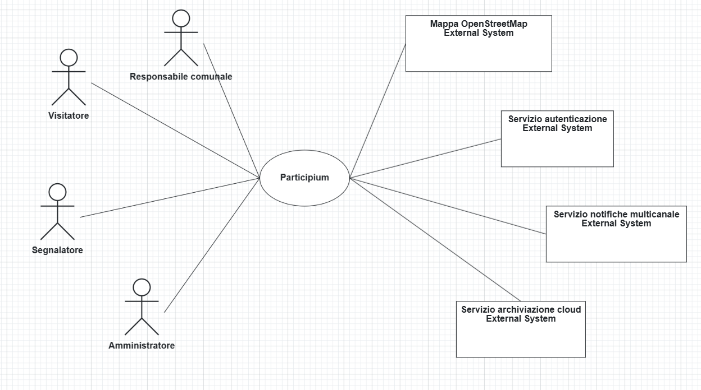

# 1) Stakeholders

| ID    | Stakeholder name                   | Description                                                                                                             | Role | Main concerns | Priority |
|:------|:-----------------------------------|:------------------------------------------------------------------------------------------------------------------------|:-----|:--------------|:---------|
| STK-1 | Amministrazione comunale di Torino | Ente responsabile della gestione dei lavori urbani                                                                      | Committente | sicurezza pubblica, reputazione, legalità              | ALTA     |
| STK-2 | Uffici comunali                    | Personale incaricato di validare le segnalazioni, assegnarle ai tecnici e aggiornare i cittadini sullo stato dei lavori | Operatore/Moderatore | tempestività, chiarezza, precisione e controllo | ALTA     |
| STK-3 | Team Infrastruttura                | Gestore dei server e dell'infrastruttura                                                                                | Amministratore | sicurezza, efficienza, costi | MEDIA    |
| STK-4 | Team di sviluppo Participium       | Gruppo incaricato dello sviluppo software                                                                               | Sviluppo     | usabilità, efficienza, manutenzione | MEDIA    |
| STK-5 | Provider cloud                     | Mettono a disposizione hardware e servizi essenziali per l'app                                                          | Fornitore | monitoraggio, fatturazione, sicurezza, rispetto policy | BASSA    |
| STK-6 | Cittadini privati                  | Usufruisce dell'app con segnalazioni e comunicazioni e monitora gli attuali problemi/eventi in città                    | Cliente  | usabilità, privacy | ALTA     |

---

# 2) Context Diagram

| Tipo | Nome | Descrizione |
|:-----|:-----|:------------|
|Utente|Visitatore|Controlla le segnalazioni e le statistiche pubbliche|
|Utente|Segnalatore|Controlla statistiche pubbliche, controlla e segue segnalazioni, aggiunge nuove segnalazioni, riceve notifiche, comunica tramite messaggi con gli operatori|
|Utente|Amministratore|Fa analisi statistiche private, gestisce aspetti di configurazione|
|Utente|Responsabile comunale|Fa verifica e revisione iniziale delle segnalazioni, gestisce il proseguimento di quelle accettate|
|Sistema esterno|Mappa OpenStreetMap|Localizza un punto della città in base a latitudine e longitudine|
|Sistema esterno|Servizio autenticazione|Gestisce il login e la verifica dell'identità|
|Sistema esterno|Servizio notifiche multicanale|Invia notifiche in app o tramite email ai cittadini che seguono una segnalazione quando questa cambia stato|
|Sistema esterno|Servizio archiviazione cloud |Archivia le immagini e le informazioni riguardanti le segnalazioni caricate dai Segnalatori, archivia le immagini del profilo dei Segnalatori|

Si assume che lo storage della maggior parte dei dati sia gestito da un servizio di archiviazione cloud esterno, le statistiche, i log, i nomi e le preferenze degli utenti, gli id e le informazioni basilari delle segnalazioni sono salvate in un database interno (vedere NFR-8)

---

# 3) Interfaces

| ID    | Interface Name                | Actor                            | Physical interface                         | Logical interface |
|:------|:------------------------------|:---------------------------------|:-------------------------------------------|:------------------|
| IF-01 | Interfaccia web visitatore    | Visitatore                       | Smartphone/PC con connessione ad Internet  | Applicazione web  |
| IF-02 | Interfaccia web segnalatore   | Segnalatore                      | Smartphone/PC con connessione ad Internet  | Applicazione web  |
| IF-03 | Interfaccia web admin         | Amministratore                   | PC con connessione ad Internet             | Applicazione web  |
| IF-04 | Interfaccia web operatore     | Responsabile comunale            | PC con connessione ad Internet             | Applicazione web  |
| IF-05 | Servizio di mappa API         | Mappa OpenStreetMap              | Connessione a Internet                     | API               |
| IF-06 | Servizio autenticazione API   | Servizio autenticazione          | Connessione a Internet                     | API               |
| IF-07 | Servizio notifiche API        | Servizio notifiche multicanale   | Connessione a Internet                     | API               |
| IF-08 | Servizio archiviazione API    | Servizio di archiviazione cloud  | Connessione ad Internet                    | API               |

---

# 4) Personas

| ID    | Name      | Role                               | Background / Context                                                                                                                                                                                                                                                                                                                                                                                                        | Goals                                                                                                                                                                                                                                                                                                                                                 | Constraints                                                                                                                                                                                                 | Devices / Usage setting                                                                                                  | Accessibility / Additional needs                                                                                                    |
|:------|:----------|:-----------------------------------|:----------------------------------------------------------------------------------------------------------------------------------------------------------------------------------------------------------------------------------------------------------------------------------------------------------------------------------------------------------------------------------------------------------------------------|:------------------------------------------------------------------------------------------------------------------------------------------------------------------------------------------------------------------------------------------------------------------------------------------------------------------------------------------------------|:------------------------------------------------------------------------------------------------------------------------------------------------------------------------------------------------------------|:-------------------------------------------------------------------------------------------------------------------------|:------------------------------------------------------------------------------------------------------------------------------------|
| PER-1 | Antonio   | Cittadino, potenziale nuovo utente | Antonio, cittadino di 60 anni, pensionato, ha scoperto dell'esistenza dell'app e del suo funzionamento, esce spesso in città e sarebbe un reporter abituale se l'applicazione offrisse un sistema veloce e semplice per registrarsi e inserire o seguire segnalazioni.Vorrebbe inoltre comunicare con il personale e gli uffici comunali.                                                                                   | Sistema di creazione account semplice e veloce (meno passaggi possibili). Funzionalità di inserimento, monitoraggio/filtraggio segnalazioni chiaro e semplice, eventualmente in forma anonima. Servizio notifiche sul cambiamento di stato segnalazione.Sistema di messaggistica con gli operatori comunali. Possibilità di seguire una segnalazione. | La registrazione richiede che l'utente sappia accedere alla sua mail e confermarla. Dal telefono, senza il consenso dell'accesso alla posizione attuale, diventa difficile selezionare la posizione esatta. | Spesso da smartphone con connessione a internet o da PC a casa con connessione a internet.                               | Una breve guida iniziale per l'inserimento delle segnalazioni e l'interazione con gli operatori comunali. Testi grandi e leggibili. | 
| PER-2 | Marco     | Operatore Comunale                 | Marco, operatore comunale, è responsabile della selezione delle segnalazioni (Approvazione o Respinta) e di interagire con gli utenti.                                                                                                                                                                                                                                                                                      | Tenere aggiornati gli utenti via chat. Consultazione e selezione di segnalazioni. Cambiamento dello stato di progresso sulle segnalazioni.                                                                                                                                                                                                            | Ha permessi limitati: non può vedere i dati privati dei cittadini per motivi di privacy, ma solo username/email e il contenuto della segnalazione.                                                          | In ufficio da PC con connessione a internet o occasionalmente da Casa via smartphone/tablet con connessione a Internet.  | Guida iniziale sul funzionamento del sistema, modalità selezione segnalazioni.                                                      | 
| PER-3 | Giovanni  | Amministratore di Sistema          | 35 anni, laureato in informatica. Gestisce l'infrastruttura server del Comune. È un utente esperto, preciso e molto attento alla sicurezza dei dati e alle prestazioni del database.                                                                                                                                                                                                                                        | Estrarre statistiche avanzate (es. top 1% dei segnalanti) per identificare utenti "super-attivi" o potenziali abusatori del sistema. Monitorare i tempi medi di risoluzione per ogni categoria per generare report di efficienza. Configurare nuove categorie o modificare parametri di sistema senza dover scrivere codice.                          | Analisi pesanti (performance). Accesso a dati sensibili, quindi deve operare sotto rigidi protocolli di logging. Non interviene mai direttamente sulle segnalazioni.                                        | Laptop aziendale protetto da VPN per interventi d'urgenza o analisi da remoto. Account con privilegi di amministratore.  | Dashboard con grafici esportabili in vari formati                                                                                   | 
| PER-4 | Luigi     | Utente visitatore                  | Luigi vuole costantemente essere aggiornato su cosa succede in città pur non disponendo di un account. Vuole poter visualizzare le segnalazioni sia su mappa sia in forma tabellare,vuole poter filtrarle per categoria e monitorarne lo stato pur non dispondendo di abilità informatiche avanzate.  Infine vorrebbe poter aver accesso alle statistiche sulle segnalazioni e poter esportare i risultati in formato CSV . | Struttura dati per segnalazioni. Comparsa segnalazioni su mappa in tempo reale. Interfaccia chiara e comprensibile per la ricerca e relativa visualizzazione delle segnalazioni.                                                                                                                                                                      | Non ha un account, non ha accettato termini di servizio specifici, quindi il sistema deve garantirgli la consultazione senza tracciare i suoi dati personali o la sua posizione GPS in modo persistente.    | Smartphone/Tablet/PC con connessione a internet                                                                          | Legenda della mappa chiara e icone auto-esplicative per le categorie                                                                |
---

# 5) User Stories

| ID    | Persona/Role                    | User story (As a… I want… so that…)                                                                                                                             |
|:------|:--------------------------------|:----------------------------------------------------------------------------------------------------------------------------------------------------------------|
| US-1  | PER-1/Utente registrato         | Come utente registrato voglio consultare e inserire segnalazioni aggingendo foto relativa categoria, eventualmente anche in forma anonima.                      |
| US-2  | PER-1/Utente registrato         | Come utente voglio creare un account per poter utilizzare la piattaforma.                                                                                       |
| US-3  | PER-1/Utente registrato         | Come utente registrato voglio poter seguire una segnalazione.                                                                                                   |
| US-4  | PER-1/Utente registrato         | Come utente registrato voglio che mi venga inviata una notifica sul cambiamento di stato delle mie segnalazioni e di quelle che seguo.                          |
| US-5  | PER-2/Operatore Comunale        | Come operatore comunale voglio avere accesso alle segnalazioni approvate in tempo reale e poter cambiare il loro stato.                                         |
| US-6  | PER-2/Operatore Comunale        | Come operatore comunale voglio poter avere accesso in tempo reale alle segnalazioni inserite e approvarle/respingerle.                                          |
| US-7  | PER-2/Operatore Comunale        | Come operatore comunale voglio poter comunicare aggiornamenti agli utenti via chat.                                                                             |
| US-8  | PER-3/Amministratore di sistema | Come amministratore di sistema voglio poter aver accesso a dati analitici avanzati.                                                                             | 
| US-9  | PER-3/Amministratore di sistema | Come amministratore di sistema voglio poter configurare nuove categorie                                                                                         | 
| US-10 | PER-4/Utente Visitatore         | Come utente visitatore voglio poter avere accesso alle segnalazioni con visualizzazione su mappa e in forma tabellare e possibilità di filtrarle per categoria. |
| US-11 | PER-4/Utente Visitatore         | Come utente visitatore voglio poter avere accesso alle statistiche di base sulle segnalazioni.                                                                  |
| US-12 | PER-4/Utente Visitatore         | Come utente visitatore voglio poter esportare i risultati in formato CSV.                                                                                       |
---

# 6) Functional Requirements (FR)

| ID      | Requirement statement (The system shall…)                                                                                                 | Priority | User story ID | Notes                                                                             |
|:--------|:------------------------------------------------------------------------------------------------------------------------------------------|:---------|:--------------|:----------------------------------------------------------------------------------|
| FR-1    | Il sistema deve consentire agli utenti di creare un account.                                                                              | ALTA     | US-2          |                                                                                   |
| FR-2    | Il sistema deve consentire agli utenti registrati di effettuare l'accesso.                                                                | ALTA     | US-2          |                                                                                   |
| FR-3    | Il sistema deve memorizzare le informazioni del profilo utente.                                                                           | ALTA     | US-2          |                                                                                   |
| FR-4    | Il sistema deve consentire agli utenti di aggiornare le informazioni del proprio profilo.                                                 | MEDIA    | US-2          |                                                                                   |
| FR-5    | Il sistema deve consentire agli utenti di inserire nuove segnalazioni.                                                                    | ALTA     | US-1          |                                                                                   |
| FR-5.1  | Il sistema deve consentire agli utenti di inserire i dati necessari per descrivere la segnalazione (titolo, descrizione, categoria, ...). | ALTA     | US-1          |                                                                                   |
| FR-5.2  | Il sistema deve consentire agli utenti di caricare delle foto relative alla segnalazione.                                                 | ALTA     | US-1          |                                                                                   |
| FR-5.3  | Il sistema deve consentire agli utenti di creare segnalazioni anonime.                                                                    | MEDIA    | US-1          |                                                                                   |
| FR-6    | Il sistema deve consentire agli utenti di visualizzare il dettaglio di una segnalazione.                                                  | ALTA     | US-3          |                                                                                   |
| FR-6.1  | Il sistema deve consentire agli utenti di seguire una segnalazione.                                                                       | ALTA     | US-3          |                                                                                   |
| FR-7    | Il sistema deve consentire agli utenti di ricevere aggiornamenti sulle segnalazioni seguite.                                              | ALTA     | US-4          | Sono comprese anche le proprie segnalazioni.                                      |
| FR-7.1  | Il sistema deve generare e inviare notifiche in piattaforma agli utenti.                                                                  | ALTA     | US-4          |                                                                                   |
| FR-7.2  | Il sistema deve generare e inviare notifiche via email agli utenti.                                                                       | MEDIA    | US-4          |                                                                                   |
| FR-8    | Il sistema deve consentire agli operatori comunali di consultare le segnalazioni approvate.                                               | ALTA     | US-5          |                                                                                   |
| FR-9    | Il sistema deve consentire agli operatori comunali di cambiare lo stato delle segnalazioni.                                               | ALTA     | US-5          |                                                                                   |
| FR-10   | Il sistema deve consentire agli operatori comunali di consultare le segnalazioni inserite.                                                | ALTA     | US-6          |                                                                                   |
| FR-11   | Il sistema deve consentire agli operatori comunali di approvare o respingere una segnalazione.                                            | ALTA     | US-6          |                                                                                   |
| FR-12   | Il sistema deve consentire agli operatori comunali di comunicare aggiornamenti via chat agli utenti.                                      | BASSA    | US-7          |                                                                                   |
| FR-13   | Il sistema deve registrare le statistiche sulle segnalazioni.                                                                             | ALTA     | US-8          |                                                                                   |
| FR-14   | Il sistema deve consentire di accedere a statistiche riguardati le segnalazioni                                                           | ALTA     | US-8/US-11    |                                                                                   |
| FR-14.1 | Il sistema deve consentire all'amministratore la visualizzazione delle statistiche private                                                | ALTA     | US-8          | Dati riguardanti il numero di segnalazioni per stato, tipologia, segnalante, etc. |
| FR-14.2 | Il sistema deve consentire a tutti gli utenti la visualizzazione delle statistiche pubbliche                                              | MEDIA    | US-11         |                                                                                   |
| FR-15   | Il sistema deve consentire all'amministratore di aggiungere/rimuovere categorie di segnalazioni.                                          | MEDIA    | US-9          |                                                                                   |
| FR-16   | Il sistema deve consentire al visitatore di consultare le segnalazioni.                                                                   | ALTA     | US-10         |                                                                                   |
| FR-16.1 | Il sistema deve consentire di visualizzare le segnalazioni sulla mappa.                                                                   | ALTA     | US-10         |                                                                                   |
| FR-16.2 | Il sistema deve consentire di visualizzare le segnalazioni in forma tabellare.                                                            | ALTA     | US-10         |                                                                                   |
| FR-17   | Il sistema deve consentire di esportare dati in formato CSV dalla forma tabellare.                                                        | BASSA    | US-12         |                                                                                   |
| FR-18   | Il sistema deve consentire all'utente di filtrare le segnalazioni.                                                                        | BASSA    | US-10/US-1    |                                                                                   |
| FR-19   | Il sistema deve consentire all'utente di ordinare le segnalazioni.                                                                        | BASSA    | US-10/US-1    |                                                                                   |

---

# 7) Non-Functional Requirements (NFR)

| ID     | Category | Requirement statement | Metric / Target | Verification                           | Priority | Notes |
|:-------|:---------|:----------------------|:----------------|:---------------------------------------|:---------|:------|
| NFR-1 | Usabilità | La piattaforma deve fornire un'interfaccia visitatore e segnalatore accessibile tramite web app che non richieda training | Tempo richiesto < 10 min | Analisi a campione, feedback | Alta | Il tempo richiesto è da intendersi come tempo necessario a padroneggiare le funzionalità dell'interfaccia, non come tempo richiesto per effettuare una nuova segnalazione |
| NFR-2 | Usabilità | La piattaforma deve fornire delle interfacce per responsabili comunali e admin accessibili tramite web app che semplifichino il lavoro | Training richiesto: 1 settimana | Feedback interni/esterni | Alta | |
| NFR-3 | Sicurezza | Le password degli utenti devono essere memorizzate usando meccanismi standard come Hash & Salt | Lunghezza e unicità dei caratteri | Il numero di caratteri per una password efficace dev'essere maggiore di 10 e bisogna utilizzare caratteri speciali | Media | |
| NFR-4 | Sicurezza | Il sistema deve crittografare i dati trasmessi tra client e server | Crittografia HTTPS | Test di sicurezza | Alta | |
| NFR-5 | Scalabilità | Il sistema deve supportare un numero massimo di utenti registrati | Utenti registrati: 1.000.000 | Test di carico (es. k6) | Alta  | |
| NFR-6 | Scalabilità | Il sistema deve supportare un numero massimo di segnalazioni al secondo | Max segnalazioni al secondo: 10 | Test di stress del sistema | Alta | Stimando 1 milione di utenti registrati e una percentule di utenti attivi giornalmente del 10%, di cui solo 1 su 20 effettua segnalazioni si arriva a circa 5000 segnalazioni al giorno |
| NFR-7 | Disponibilità | Il sistema deve fornire una disponibilità elevata | Disponibilità mensile > 98.0% | Verifica del funzionamento del sistema web | Alta | Importante è una disponibilità costante perché i problemi vengono aggiunti/aggiornati di frequente |
| NFR-8 | Efficenza | Il sistema deve possedere uno storage interno di dimensioni appropriate | Storage: 30GB | Check storage disponibile | Alta | Considerando 1 milione di utenti registrati, ognuno richiede al massimo 4KB di informazioni salvate nello storage, circa 2GB di indici del DBMS e al massimo 20GB per log/statistiche  |
| NFR-9 | Efficenza | I messaggi tra segnalatori e operatori devono arrivare velocemente | Tempo richiesto < 1 secondo | Testing | Bassa | |
| NFR-10 | Prestazioni | Il sistema deve caricare la mappa relativa alle segnalazioni in un tempo specifico | Tempo di caricamento < 2 secondi per il 90% delle richieste | Test di performance | Alta | |
| NFR-11 | Compatibilità | Il sistema deve supportare i browser web moderni con versione successiva al 2022 | Versione Chrome > 108, Versione Firefox > 108, Versione Safari > 16 | La verifica avviene con il test del software sul browser selezionato | Media ||
| NFR-12 | Manutenibilità | L'aggiunta/modifica di una feature riguardo alle segnalazioni deve richiedere un effort massimo | Effort < 16ph | Testing empirico | Media | La feature può essere l'aggiunta di una nuova categoria |