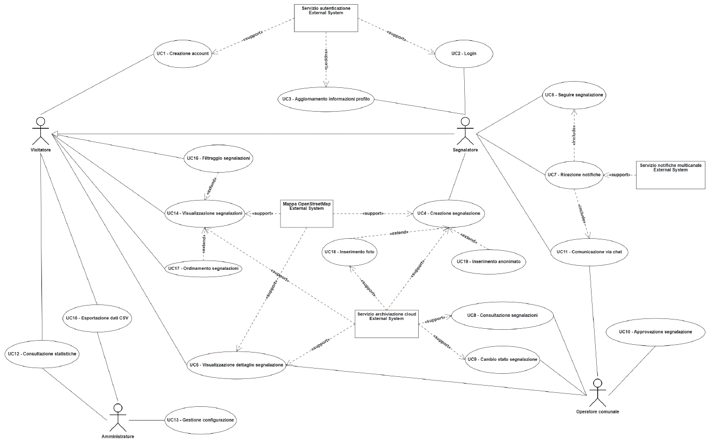

# 1) Use Case Diagram

## Note

# 2) Use Case Narratives

UC1 - Creazione Account
-
  
| Use Case                | Creazione Account                                                                                                                                                                                                                                                                                                                                                                                               |
|:------------------------|:----------------------------------------------------------------------------------------------------------------------------------------------------------------------------------------------------------------------------------------------------------------------------------------------------------------------------------------------------------------------------------------------------------------|
| ID                      | UC1                                                                                                                                                                                                                                                                                                                                                                                                             |
| Scope                   | Piattaforma Participium                                                                                                                                                                                                                                                                                                                                                                                         |
| Level                   | User goal                                                                                                                                                                                                                                                                                                                                                                                                       |
| Intention in Context    | Creare un nuovo account                                                                                                                                                                                                                                                                                                                                                                                         |
| Primary actor           | Visitatore                                                                                                                                                                                                                                                                                                                                                                                                      |
| Supporting actors       | -                                                                                                                                                                                                                                                                                                                                                                                                               |
| Stakeholders' interests | Proprietà: avere utenti univoci e dati coerenti                                                                                                                                                                                                                                                                                                                                                                 |
| Precondition            | -                                                                                                                                                                                                                                                                                                                                                                                                               |
| Minimum guarantees      | -                                                                                                                                                                                                                                                                                                                                                                                                               |
| Success guarantees      | Il sistema crea l'account e memorizza le informazioni dell'utente registrato                                                                                                                                                                                                                                                                                                                                    |
| Trigger                 | -                                                                                                                                                                                                                                                                                                                                                                                                               |
| Main success scenario   | 1. L'utente chiede di registrarsi a Participium   2. La piattaforma mostra la pagina di registrazione   3. L'utente inserisce i dati del suo account   4. Il sistema valida i dati   5. L'utente conferma l'indirizzo email   6. Il sistema crea l'account e salva le informazioni del profilo [FR1, FR3]   Il caso d'uso termina con successo                                                |
| Extensions              | 3a. L'utente annulla la registrazione   3a.1 Il sistema non crea l'account, il caso d'uso termina con un fallimento    4a. I dati inseriti non sono validi o sono incompleti   4a.1 Il sistema mostra gli errori e il caso d'uso riprende dal punto 2    4b. L'identificativo dell'utente risulta già presente    4b.1 Il sistema segnala il problema e il caso d'uso riprende dal punto 2 |

UC2 - Login
-
  
| Use Case                | Login                                                                                                                                                                                                                                                                                                                                                                 |
|:------------------------|:----------------------------------------------------------------------------------------------------------------------------------------------------------------------------------------------------------------------------------------------------------------------------------------------------------------------------------------------------------------------|
| ID                      | UC2                                                                                                                                                                                                                                                                                                                                                                   |
| Scope                   | Piattaforma Participium                                                                                                                                                                                                                                                                                                                                               |
| Level                   | User goal                                                                                                                                                                                                                                                                                                                                                             |
| Intention in Context    | Accedere alla piattaforma                                                                                                                                                                                                                                                                                                                                             |
| Primary actor           | Segnalatore                                                                                                                                                                                                                                                                                                                                                           |
| Supporting actors       | Servizio autenticazione                                                                                                                                                                                                                                                                                                                                               |
| Stakeholders' interests | Proprietà: solo gli utenti registrati possono creare una nuova segnalazione                                                                                                                                                                                                                                                                                           |
| Precondition            | -                                                                                                                                                                                                                                                                                                                                                                     |
| Minimum guarantees      | -                                                                                                                                                                                                                                                                                                                                                                     |
| Success guarantees      | L'utente è autenticato e autorizzato                                                                                                                                                                                                                                                                                                                                  |
| Trigger                 | -                                                                                                                                                                                                                                                                                                                                                                     |
| Main success scenario   | 1. L'utente chiede di loggarsi al suo account Participium  2. La piattaforma mostra la pagina di login   3. L'utente inserisce username e password   4. Il sistema invia i dati al servizio di autenticazione   5. Il servizio di autenticazione manda esito positivo   6. Il sistema autorizza l'utente [FR2]   Il caso d'uso termina con successo |
| Extensions              | 5a. Il servizio di autenticazione manda esito negativo   5a.1 Il sistema non autorizza l'utente e il caso d'uso riprende dal punto 2    2a. L'utente annulla l'operazione   2a.1 Il sistema interrompe il login, il caso d'uso termina con un fallimento                                                                                                  |

UC3 - Aggiornamento informazioni profilo
-
  
| Use Case                | Login                                                                                                                                                                                                                                                                                                                                                                                              |
|:------------------------|:---------------------------------------------------------------------------------------------------------------------------------------------------------------------------------------------------------------------------------------------------------------------------------------------------------------------------------------------------------------------------------------------------|
| ID                      | UC3                                                                                                                                                                                                                                                                                                                                                                                                |
| Scope                   | Piattaforma Participium                                                                                                                                                                                                                                                                                                                                                                            |
| Level                   | User goal                                                                                                                                                                                                                                                                                                                                                                                          |
| Intention in Context    | Modificare informazioni e preferenze del proprio profilo                                                                                                                                                                                                                                                                                                                                           |
| Primary actor           | Segnalatore                                                                                                                                                                                                                                                                                                                                                                                        |
| Supporting actors       | -                                                                                                                                                                                                                                                                                                                                                                                                  |
| Stakeholders' interests | Proprietà: avere dati profilo aggiornati e consistenti                                                                                                                                                                                                                                                                                                                                             |
| Precondition            | -                                                                                                                                                                                                                                                                                                                                                                                                  |
| Minimum guarantees      | In caso di fallimento le informazioni restano invariate                                                                                                                                                                                                                                                                                                                                            |
| Success guarantees      | I dati del profilo sono aggiornati                                                                                                                                                                                                                                                                                                                                                                 |
| Trigger                 | -                                                                                                                                                                                                                                                                                                                                                                                                  |
| Main success scenario   | 1. L'utente chiede di aggiornare il suo profilo   2. La piattaforma mostra la pagina del profilo   3. L'utente modifica i dati desiderati e conferma  4. Il sistema valida e memorizza i dati modificati [FR4]   5. L'utente chiede di visualizzare il profilo aggiornato   6. Il sistema mostra il profilo con le nuove informazioni [FR3]   Il caso d'uso termina con successo |
| Extensions              | 3a. L'utente annulla la modifica   3a.1 Il sistema non salva nessuna modifica, il caso d'uso termina con un fallimento    4a. I dati modificati non rispettano i vincoli previsti   4a.1 Il sistema mostra gli errori e il caso d'uso riprende dal punto 2                                                                                                                             |

UC4 - Creazione Segnalazione
-
  
| Use Case                | Creazione Segnalazione                                                                                                                                                                                                                                                                                                                                                                                                   |
|:------------------------|:-------------------------------------------------------------------------------------------------------------------------------------------------------------------------------------------------------------------------------------------------------------------------------------------------------------------------------------------------------------------------------------------------------------------------|
| ID                      | UC4                                                                                                                                                                                                                                                                                                                                                                                                                      |
| Scope                   | Piattaforma Participium                                                                                                                                                                                                                                                                                                                                                                                                  |
| Level                   | User goal                                                                                                                                                                                                                                                                                                                                                                                                                |
| Intention in Context    | Segnalare un problema in città                                                                                                                                                                                                                                                                                                                                                                                           |
| Primary actor           | Segnalatore                                                                                                                                                                                                                                                                                                                                                                                                              |
| Supporting actors       | Servizio archiviazione cloud, OpenStreetMap                                                                                                                                                                                                                                                                                                                                                                              |
| Stakeholders' interests | Segnalatore: il problema deve poter essere spiegato nel dettaglio, deve essere possibile restare anonimi, Proprietà: le statistiche devono essere aggiornate e affidabili                                                                                                                                                                                                                                                |
| Precondition            | -                                                                                                                                                                                                                                                                                                                                                                                                                        |
| Minimum guarantees      | In caso di problemi non vengono inviate segnalazioni incomplete                                                                                                                                                                                                                                                                                                                                                          |
| Success guarantees      | La segnalazione viene creata ed inviata per la revisione                                                                                                                                                                                                                                                                                                                                                                 |
| Trigger                 | -                                                                                                                                                                                                                                                                                                                                                                                                                        |
| Main success scenario   | 1. L'utente chiede di creare una segnalazione   2. La piattaforma mostra la pagina di creazione di una nuova segnalazione   3. L'utente cerca la posizione sulla mappa e inserisce i dettagli del problema [FR-5.1]  Il sistema convalida i dati, registra la segnalazione in modo permanente e notifica la ricezione ai responsabili comunali [FR5,FR-13].   Il caso d'uso termina con successo             |
| Extensions              | 3a. L'utente annulla l'operazione   3a.1 Il sistema non salva nessuna segnalazione, il caso d'uso termina con un fallimento    3b L'utente richiede di restare anonimo   3b.1 Il sistema nasconde il nome del segnalatore e il caso d'uso riprende dal punto 4    4a. Il servizio di archiviazione non è raggiungibile   4a.1  Il sistema mostra un errore, il caso d'uso termina con un fallimento |

UC5 - Visualizzazione dettaglio segnalazione
-
  
| Use Case                | Visualizzazione dettaglio segnlazione                                                                                                                                                                                                                                                                                          |
|:------------------------|:-------------------------------------------------------------------------------------------------------------------------------------------------------------------------------------------------------------------------------------------------------------------------------------------------------------------------------|
| ID                      | UC5                                                                                                                                                                                                                                                                                                                            |
| Scope                   | Piattaforma Participium                                                                                                                                                                                                                                                                                                        |
| Level                   | User goal                                                                                                                                                                                                                                                                                                                      |
| Intention in Context    | Controllare i dettagli di una segnalazione esistente                                                                                                                                                                                                                                                                           |
| Primary actor           | Visitatore                                                                                                                                                                                                                                                                                                                     |
| Supporting actors       | Servizio archiviazione cloud, OpenStreetMap                                                                                                                                                                                                                                                                                    |
| Stakeholders' interests | Proprietà: Ogni segnalazione deve essere consultabile in dettaglio                                                                                                                                                                                                                                                             |
| Precondition            | -                                                                                                                                                                                                                                                                                                                              |
| Minimum guarantees      | -                                                                                                                                                                                                                                                                                                                              |
| Success guarantees      | L'utente accede alla pagina di dettaglio della segnalazione                                                                                                                                                                                                                                                                    |
| Trigger                 | -                                                                                                                                                                                                                                                                                                                              |
| Main success scenario   | 1. L'utente chiede di visualizzare una segnalazione   2. La piattaforma chiede i dati al servizio di archiviazione   3. Il servizio restituisce le informazioni riguardanti la segnalazioni al sistema  4. Il sistema mostra la pagina di dettaglio della segnalazione [FR-6]   Il caso d'uso termina con successo |
| Extensions              | 3a. Il servizio di archiviazione non è raggiungibile   3a.1 Il sistema mostra un messaggio di errore, il caso d'uso termina con un fallimento                                                                                                                                                                               |

## UC6 - Seguire segnalazione

| Use Case                | Seguire segnalazione                                                                                                                                                                                                                                                                                                                                                                                                                          |
| :---------------------- |:----------------------------------------------------------------------------------------------------------------------------------------------------------------------------------------------------------------------------------------------------------------------------------------------------------------------------------------------------------------------------------------------------------------------------------------------|
| ID                      | UC6                                                                                                                                                                                                                                                                                                                                                                                                                                           |
| Scope                   | Piattaforma Participium                                                                                                                                                                                                                                                                                                                                                                                                                       |
| Level                   | User goal                                                                                                                                                                                                                                                                                                                                                                                                                                     |
| Intention in Context    | Ricevere aggiornamenti su una segnalazione di interesse                                                                                                                                                                                                                                                                                                                                                                                       |
| Primary actor           | Segnalatore                                                                                                                                                                                                                                                                                                                                                                                                                                   |
| Supporting actors       | Servizio notifiche multicanale                                                                                                                                                                                                                                                                                                                                                                                                                |
| Stakeholders' interests | Segnalatore: rimanere aggiornato sullo stato della segnalazione   Proprietà: aumentare engagement e trasparenza del servizio                                                                                                                                                                                                                                                                                                               |
| Precondition            | La segnalazione esiste ed è visualizzabile                                                                                                                                                                                                                                                                                                                                                                                                    |
| Minimum guarantees      | In caso di errore l’utente non viene registrato come follower                                                                                                                                                                                                                                                                                                                                                                                 |
| Success guarantees      | L’utente segue la segnalazione e riceverà aggiornamenti                                                                                                                                                                                                                                                                                                                                                                                       |
| Trigger                 | L’utente decide di seguire una segnalazione                                                                                                                                                                                                                                                                                                                                                                                                   |
| Main success scenario   | 1. L’utente visualizza il dettaglio di una segnalazione [FR-6]   2. L’utente seleziona l’opzione per seguire la segnalazione   3. Il sistema registra l’utente tra i follower della segnalazione [FR-6.1]   4. Il sistema attiva il servizio di notifiche per inviare aggiornamenti [FR-7, FR-7.1, FR-7.2]   5. Il sistema conferma all’utente che sta seguendo la segnalazione   Il caso d’uso termina con successo           |
| Extensions              | 2a. L’utente annulla l’operazione   2a.1 Il sistema non registra alcuna iscrizione, il caso d’uso termina con un fallimento    3a. L’utente sta già seguendo la segnalazione   3a.1 Il sistema informa l’utente e il caso d’uso termina con successo    4a. Il servizio notifiche non è disponibile   4a.1 Il sistema registra comunque il follow ma informa l’utente che le notifiche potrebbero non essere disponibili |

## UC7 - Ricezione notifiche

| Use Case                | Ricezione notifiche                                                                                                                                                                                                                                                                                                                                                                                                      |
| :---------------------- |:-------------------------------------------------------------------------------------------------------------------------------------------------------------------------------------------------------------------------------------------------------------------------------------------------------------------------------------------------------------------------------------------------------------------------|
| ID                      | UC7                                                                                                                                                                                                                                                                                                                                                                                                                      |
| Scope                   | Piattaforma Participium                                                                                                                                                                                                                                                                                                                                                                                                  |
| Level                   | User goal                                                                                                                                                                                                                                                                                                                                                                                                                |
| Intention in Context    | Ricevere aggiornamenti sulle segnalazioni seguite                                                                                                                                                                                                                                                                                                                                                                        |
| Primary actor           | Segnalatore                                                                                                                                                                                                                                                                                                                                                                                                              |
| Supporting actors       | Servizio notifiche multicanale                                                                                                                                                                                                                                                                                                                                                                                           |
| Stakeholders' interests | Segnalatore: essere informato tempestivamente sugli aggiornamenti   Proprietà: garantire comunicazioni affidabili ed efficienti                                                                                                                                                                                                                                                                                       |
| Precondition            | L’utente segue almeno una segnalazione                                                                                                                                                                                                                                                                                                                                                                                   |
| Minimum guarantees      | In caso di errore nessuna notifica viene recapitata, senza compromettere i dati                                                                                                                                                                                                                                                                                                                                          |
| Success guarantees      | L’utente riceve una notifica relativa a un aggiornamento di una segnalazione seguita                                                                                                                                                                                                                                                                                                                                     |
| Trigger                 | Si verifica un aggiornamento su una segnalazione seguita                                                                                                                                                                                                                                                                                                                                                                 |
| Main success scenario   | 1. Si verifica un aggiornamento su una segnalazione (es. cambio stato, commento)   2. Il sistema genera una notifica per gli utenti che seguono la segnalazione [FR-7]   3. Il sistema invia la notifica tramite i canali disponibili (in piattaforma, email) [FR-7.1, FR-7.2]   4. L’utente riceve la notifica   5. L’utente accede al dettaglio della segnalazione   Il caso d’uso termina con successo |
| Extensions              | 3a. Il servizio notifiche non è disponibile   3a.1 Il sistema non invia la notifica e può ritentare successivamente    4a. L’utente ha disabilitato un canale di notifica   4a.1 Il sistema utilizza solo i canali attivi disponibili                                                                                                                                                                        |

## UC8 - Consultazione segnalazioni

| Use Case                | Consultazione segnalazioni                                                                                                                                                                                                                                                                                        |
| :---------------------- |:------------------------------------------------------------------------------------------------------------------------------------------------------------------------------------------------------------------------------------------------------------------------------------------------------------------|
| ID                      | UC8                                                                                                                                                                                                                                                                                                               |
| Scope                   | Piattaforma Participium                                                                                                                                                                                                                                                                                           |
| Level                   | User goal                                                                                                                                                                                                                                                                                                         |
| Intention in Context    | Consultare le segnalazioni approvate presenti nel sistema                                                                                                                                                                                                                                                         |
| Primary actor           | Operatore comunale                                                                                                                                                                                                                                                                                                |
| Supporting actors       | Servizio archiviazione cloud                                                                                                                                                                                                                                                                                      |
| Stakeholders' interests | Operatore comunale: accedere rapidamente alle segnalazioni approvate   Proprietà: garantire accesso controllato e dati aggiornati                                                                                                                                                                              |
| Precondition            | Esistono segnalazioni approvate nel sistema                                                                                                                                                                                                                                                                       |
| Minimum guarantees      | In caso di errore nessun dato viene modificato                                                                                                                                                                                                                                                                    |
| Success guarantees      | L’operatore visualizza l’elenco delle segnalazioni approvate                                                                                                                                                                                                                                                      |
| Trigger                 | -                                                                                                                                                                                                                                                                                                                 |
| Main success scenario   | 1. L’operatore accede alla sezione delle segnalazioni   2. Il sistema richiede le segnalazioni approvate al servizio di archiviazione [FR-8]   3. Il servizio restituisce i dati delle segnalazioni   4. Il sistema mostra l’elenco delle segnalazioni approvate   Il caso d’uso termina con successo |
| Extensions              | 2a. Il servizio di archiviazione non è disponibile   2a.1 Il sistema mostra un messaggio di errore, il caso d’uso termina con un fallimento                                                                                                                                                                    |

## UC9 - Cambio stato segnalazione

| Use Case                | Modifica stato segnalazione                                                                                                                                                                                                                                       |
| :---------------------- |:------------------------------------------------------------------------------------------------------------------------------------------------------------------------------------------------------------------------------------------------------------------|
| ID                      | UC9                                                                                                                                                                                                                                                               |
| Scope                   | Piattaforma Participium                                                                                                                                                                                                                                           |
| Level                   | User goal                                                                                                                                                                                                                                                         |
| Intention in Context    | Aggiornare lo stato di una segnalazione                                                                                                                                                                                                                           |
| Primary actor           | Operatore comunale                                                                                                                                                                                                                                                |
| Supporting actors       | Servizio archiviazione cloud                                                                                                                                                                                                                                      |
| Stakeholders' interests | Operatore comunale: aggiornare correttamente lo stato delle segnalazioni   Segnalatore: essere informato sugli aggiornamenti   Proprietà: mantenere dati coerenti e aggiornati                                                                              |
| Precondition            | La segnalazione esiste ed è consultabile                                                                                                                                                                                                                          |
| Minimum guarantees      | In caso di errore lo stato della segnalazione resta invariato                                                                                                                                                                                                     |
| Success guarantees      | Lo stato della segnalazione viene aggiornato                                                                                                                                                                                                                      |
| Trigger                 | -                                                                                                                                                                                                                                                                 |
| Main success scenario   | 1. L’operatore visualizza il dettaglio di una segnalazione [FR-10]   2. L’operatore seleziona un nuovo stato per la segnalazione   3. Il sistema aggiorna lo stato della segnalazione [FR-9]  Il caso d’uso termina con successo                            |
| Extensions              | 3a. Lo stato selezionato non è valido   3a.1 Il sistema mostra un errore e il caso d’uso riprende dal punto 2    3b. Il servizio di archiviazione cloud non è disponibile   3b.1 Il sistema mostra un errore, il caso d’uso termina con un fallimento |

## UC10 - Approvazione segnalazione

| Use Case                | Approvazione/respinta segnalazione                                                                                                                                                                                               |
| :---------------------- |:---------------------------------------------------------------------------------------------------------------------------------------------------------------------------------------------------------------------------------|
| ID                      | UC10                                                                                                                                                                                                                             |
| Scope                   | Piattaforma Participium                                                                                                                                                                                                          |
| Level                   | User goal                                                                                                                                                                                                                        |
| Intention in Context    | Approvare/Respingere una segnalazione                                                                                                                                                                                            |
| Primary actor           | Operatore comunale                                                                                                                                                                                                               |
| Supporting actors       | -                                                                                                                                                                                                                                |
| Stakeholders' interests | Operatore comunale: approvare segnalazioni rilevanti e respingere quelle gia in fase di lavorazione o inappropriate    Segnalatore: essere informato sugli aggiornamenti   Proprietà: mantenere dati coerenti e aggiornati |
| Precondition            | Esistono segnalazioni inserite in attesa di approvazione                                                                                                                                                                         |
| Minimum guarantees      | In caso di errore nessuna segnalazione viene rimossa                                                                                                                                                                             |
| Success guarantees      | Lo stato iniziale della segnalazione viene aggiornato                                                                                                                                                                            |
| Trigger                 | -                                                                                                                                                                                                                                |
| Main success scenario   | 1. L'operatore visualizza le nuove segnalazioni inserite.   2. L’operatore approva/respinge la segnalazione   3. Il sistema aggiorna lo stato della segnalazione [FR-11]  Il caso d’uso termina con successo               |
| Extensions              | 2a. L'operatore annulla l'operazione   2a.1 Lo stato iniziale della segnalazione non viene modificato, il caso d'uso termina con un fallimento                                                                                | 

## UC11 - Comunicazione via chat

| Use Case                | Comunicazione via chat                                                                                                                                                                                                                                                                                                 |
| :---------------------- |:-----------------------------------------------------------------------------------------------------------------------------------------------------------------------------------------------------------------------------------------------------------------------------------------------------------------------|
| ID                      | UC11                                                                                                                                                                                                                                                                                                                   |
| Scope                   | Piattaforma Participium                                                                                                                                                                                                                                                                                                |
| Level                   | User goal                                                                                                                                                                                                                                                                                                              |
| Intention in Context    | Comunicazione via chat tra operatore e segnalatore                                                                                                                                                                                                                                                                     |
| Primary actor           | Operatore comunale, Segnalatore                                                                                                                                                                                                                                                                                        |
| Supporting actors       | -                                                                                                                                                                                                                                                                                                                      |
| Stakeholders' interests | Operatore comunale: ricevere chiarimenti o fornire aggiornamenti    Segnalatore: essere informato sugli aggiornamenti   Proprietà: mantenere i cittadini aggiornati e visione completa della segnalazione                                                                                                        |
| Precondition            | Esistono segnalazioni inserite                                                                                                                                                                                                                                                                                         |
| Minimum guarantees      | In caso di errori, nessuna segnalazione viene rimossa                                                                                                                                                                                                                                                                  |
| Success guarantees      | Invio e rispettiva ricezione del messaggio                                                                                                                                                                                                                                                                             |
| Trigger                 | -                                                                                                                                                                                                                                                                                                                      |
| Main success scenario   | 1. L'operatore fornisce aggiornamenti/chiede informazioni via chat sulla segnalazione. [FR-12]   2. Il messaggio viene ricevuto dal segnalatore [FR-7.1,FR-7.2]   3. Il segnalatore risponde all'operatore via chat.   4. Il messaggio viene ricevuto dall'operatore.   Il caso d'uso termina con successo |
| Extensions              | 1a. L'operatore annulla l'operazione   1a.1 Il messaggio non viene inviato, il caso d'uso termina con un fallimento   3a Il file inviato è troppo pesante: il sistema mostra un errore e il caso d'uso riprende dal punto 3.                                                                                     | 

## UC12 - Consultazione statistiche

| Use Case                | Consultazione statistiche                                                                                                                                                                                                                                                                                                                                  |
| :---------------------- |:-----------------------------------------------------------------------------------------------------------------------------------------------------------------------------------------------------------------------------------------------------------------------------------------------------------------------------------------------------------|
| ID                      | UC12                                                                                                                                                                                                                                                                                                                                                       |
| Scope                   | Piattaforma Participium                                                                                                                                                                                                                                                                                                                                    |
| Level                   | User goal                                                                                                                                                                                                                                                                                                                                                  |
| Intention in Context    | Consultazione statistiche                                                                                                                                                                                                                                                                                                                                  |
| Primary actor           | Amministratore, Visitatore                                                                                                                                                                                                                                                                                                                     |
| Supporting actors       | Database interno                                                                                                                                                                                                                                                                                                                                           |
| Stakeholders' interests | Utenti visitatori/segnalatori: trasparenza   Amministratore: monitoraggio interno   Operatore: monitoraggio                                                                                                                                                                                                                                          |
| Precondition            | -                                                                                                                                                                                                                                                                                                                                                          |
| Minimum guarantees      | Nessun dato perso in caso di errore, i dati sensibili rimangono protetti e non accessibili a utenti non autorizzati                                                                                                                                                                                                                                        |
| Success guarantees      | Visualizzazione completa o meno delle statistiche a seconda del tipo di utente                                                                                                                                                                                                                                                                             |
| Trigger                 | -                                                                                                                                                                                                                                                                                                                                                          |
| Main success scenario   | 1. L'amministratore (o utente) richiede la visualizzazione delle statistiche.   2. Il sistema richiede all'utente la tipologia di statistica che vuole visualizzare   3. L'utente seleziona la tipologia di statistica   4. I dati vengono mostrati all'utente [FR-13]   5.L'utente visualizza i dati.   Il caso d'uso termina con successo |
| Extensions              | 4a. La tipologia non viene cosiderata valida:il sistema mostra un errore e il caso d'uso riprende dal punto 2     3a L'utente annulla l'operazione.   3a.1 Il sistema mostra il menu principale, il caso d'uso termina con un fallimento                                                                                                          | 

## UC13 - Gestione configurazione

| Use Case                | Gestione configurazione                                                                                                                                                                                                                                                                                                                                                                                                         |
| :---------------------- |:--------------------------------------------------------------------------------------------------------------------------------------------------------------------------------------------------------------------------------------------------------------------------------------------------------------------------------------------------------------------------------------------------------------------------------|
| ID                      | UC13                                                                                                                                                                                                                                                                                                                                                                                                                            |
| Scope                   | Piattaforma Participium                                                                                                                                                                                                                                                                                                                                                                                                         |
| Level                   | User goal                                                                                                                                                                                                                                                                                                                                                                                                                       |
| Intention in Context    | Gestire e personalizzare le impostazioni operative della piattaforma (es. categorie, priorità, permessi)                                                                                                                                                                                                                                                                                                                        |
| Primary actor           | Amministratore                                                                                                                                                                                                                                                                                                                                                                                                                  |
| Supporting actors       | -                                                                                                                                                                                                                                                                                                                                                                                                                               |
| Stakeholders' interests | Utenti visitatori/segnalatori: segnalazioni precise   Amministratore: monitoraggio interno e mantenere la piattaforma aggiornata   Operatore: gestione segnalazioni                                                                                                                                                                                                                                                       |
| Precondition            | L'Amministratore ha effettuato l'accesso all'area riservata con permessi di configurazione                                                                                                                                                                                                                                                                                                                                      |
| Minimum guarantees      | Le configurazioni esistenti non vengono corrotte                                                                                                                                                                                                                                                                                                                                                                                |
| Success guarantees      | I nuovi parametri (es. nuova categoria) sono salvati e immediatamente disponibili per gli utenti della piattaforma                                                                                                                                                                                                                                                                                                              |
| Trigger                 | -                                                                                                                                                                                                                                                                                                                                                                                                                               |
| Main success scenario   | 1. L'amministratore richiede l'inserimento di una nuova categoria di segnalazione   2. Il sistema mostra all' admin il modulo di inserimento (nome, icona, priorità ecc..)    3. L'amministratore inserisce i dati e conferma l'inserimento   4. Il sistema valida o dati e aggiorna il database interno [FR-15]   5.Il sistema conferma l'avvenuta configurazione [FR-5.1]   Il caso d'uso termina con successo |
| Extensions              | 3a. L'amministratore annulla l'operazione     3a.1 Il sistema non aggiorna il database interno. Il caso d'uso termina con un fallimento.   4a Il sistema non valida l'operazione perche i dati forniti sono incompleti. Il caso d'uso riprende dal punto 2.                                                                                                                                                            | 

## UC14 - Visualizzazione segnalazioni

| Use Case                | Visualizzazione segnalazioni                                                                                                                                                                                                                        |
| :---------------------- |:----------------------------------------------------------------------------------------------------------------------------------------------------------------------------------------------------------------------------------------------------|
| ID                      | UC14                                                                                                                                                                                                                                                |
| Scope                   | Piattaforma Participium                                                                                                                                                                                                                             |
| Level                   | User goal                                                                                                                                                                                                                                           |
| Intention in Context    | Visualizzazione delle segnalazioni su mappa o in formato tabellare                                                                                                                                                                                  |
| Primary actor           | Visitatore                                                                                                                                                                                                                                          |
| Supporting actors       | Sistema archiviazione Cloud, OpenStreetMap                                                                                                                                                                                                          |
| Stakeholders' interests | Utenti visitatori/segnalatori: Visualizzazione segnalazione   Amministratore: monitoraggio e controllo   Operatore: monitoraggio e controllo                                                                                                  |
| Precondition            | Sono presenti segnalazioni attive (nel caso della visualizzazione su mappa)                                                                                                                                                                         |
| Minimum guarantees      | Nessuna segnalazione viene rimossa/persa dal database nel caso di errori                                                                                                                                                                            |
| Success guarantees      | L'utente visualizza correttamente la lista delle segnalazioni in forma tabellare esulla mappa                                                                                                                                                       |
| Trigger                 | -                                                                                                                                                                                                                                                   |
| Main success scenario   | 1. L'utente apre la pagina associata alle segnalazioni   2. Il sistema mostra la mappa con le segnalazioni attive e una lista strutturata per la ricerca/filtraggio/ordinamento [FR-16.1, FR16.2,FR-10]   Il caso d'uso termina con successo. |
| Extensions              |                                                                                                                                                                                                                                                     | 

## UC15 - Esportazione dati CSV

| Use Case                | Esportazione dati CSV                                                                                                                                                                                                                                                                                                                                                                                                                                                                                                                                 |
| :---------------------- |:------------------------------------------------------------------------------------------------------------------------------------------------------------------------------------------------------------------------------------------------------------------------------------------------------------------------------------------------------------------------------------------------------------------------------------------------------------------------------------------------------------------------------------------------------|
| ID                      | UC15                                                                                                                                                                                                                                                                                                                                                                                                                                                                                                                                                  |
| Scope                   | Piattaforma Participium                                                                                                                                                                                                                                                                                                                                                                                                                                                                                                                               |
| Level                   | User goal                                                                                                                                                                                                                                                                                                                                                                                                                                                                                                                                             |
| Intention in Context    | Esportazione dati in formato CSV per analisi specifiche e trasparenza.                                                                                                                                                                                                                                                                                                                                                                                                                                                                                |
| Primary actor           | Amministratore, Operatore, Visitatore                                                                                                                                                                                                                                                                                                                                                                                                                                                                                                                 |
| Supporting actors       | -                                                                                                                                                                                                                                                                                                                                                                                                                                                                                                                                                     |
| Stakeholders' interests | Amministratore: analisi avanzate   Operatore: analisi e trasparenza   Utente Visitatore: trasparenza e condivisione                                                                                                                                                                                                                                                                                                                                                                                                                             |
| Precondition            | Sono presenti segnalazioni nel sistema e l'utente si trova nella visualizzazione tabellare delle segnalazioni.                                                                                                                                                                                                                                                                                                                                                                                                                                        |
| Minimum guarantees      | Nessuna segnalazione viene rimossa/persa dal database nel caso di errori                                                                                                                                                                                                                                                                                                                                                                                                                                                                              |
| Success guarantees      | L'utente esporta correttamente i risultati associati ad una ricerca dalla lista strutturata in formato CSV                                                                                                                                                                                                                                                                                                                                                                                                                                            |
| Trigger                 | -                                                                                                                                                                                                                                                                                                                                                                                                                                                                                                                                                     |
| Main success scenario   | 1. L'amministratore/operatore/utente richiede la ricerca di segnalazioni di interesse in formato tabellare.   2. Il sistema mostra all'utente il modulo da compilare con i dati per il filtraggio delle segnalazioni.   3. L'utente inserisce i dati.   4. Il sistema mostra all'utente le segnalazioni di interesse.   5. L'utente richiede l'esportazione dei dati di interesse in formato CSV. [FR-17]   6. Il sistema genera il file CSV e avvia il download sul dispositivo dell'utente.   Il caso d'uso termina con successo. |
| Extensions              | 3a. L'utente annulla l'operazione.   3a.1 Il sistema non mostra le segnalazioni perche non è fornita alcuna informazione.Il caso d'uso termina con un fallimento   4a. Il sistema non valida i dati inseriti perchè non associati a nessuna segnalazione: il sistema mostra un errore e il caso d'uso riprende dal punto 2                                                                                                                                                                                                                      | 

## UC16 - Filtraggio segnalazioni

| Use Case                | Filtraggio segnalazioni                                                                                                                                                                                                                                                                                                                                                                              |
| :---------------------- |:-----------------------------------------------------------------------------------------------------------------------------------------------------------------------------------------------------------------------------------------------------------------------------------------------------------------------------------------------------------------------------------------------------|
| ID                      | UC16                                                                                                                                                                                                                                                                                                                                                                                                 |
| Scope                   | Piattaforma Participium                                                                                                                                                                                                                                                                                                                                                                              |
| Level                   | User goal                                                                                                                                                                                                                                                                                                                                                                                            |
| Intention in Context    | Filtraggio segnalazioni in funzione di ottenere solo quelle di interesse                                                                                                                                                                                                                                                                                                                             |
| Primary actor           | Visitatore                                                                                                                                                                                                                                                                                                                                                                                           |
| Supporting actors       | OpenStreetMap                                                                                                                                                                                                                                                                                                                                                                                        |
| Stakeholders' interests | Amministratore: esportazione formato CSV   Utente Visitatore: ricerca segnalazioni di interesse    Operatore: monitoraggio e controllo                                                                                                                                                                                                                                                         |
| Precondition            | Sono presenti segnalazioni nel sistema e l'utente si trova nella visualizzazione tabellare/su mappa delle segnalazioni.                                                                                                                                                                                                                                                                              |
| Minimum guarantees      | Nessuna segnalazione viene rimossa/persa dal database nel caso di errori                                                                                                                                                                                                                                                                                                                             |
| Success guarantees      | L'utente ottiene le segnalazioni associate ai filtri applicati                                                                                                                                                                                                                                                                                                                                       |
| Trigger                 | -                                                                                                                                                                                                                                                                                                                                                                                                    |
| Main success scenario   | 1. L'utente richiede il filtraggio delle segnalazioni   2. Il sistema mostra all'utente il modulo da compilare con i dati per il filtraggio delle segnalazioni.   3. L'utente inserisce i dati.   4. Il sistema valida i dati inseriti dall'utente e mostra all'utente le segnalazioni di interesse sia in formato tabellare che su mappa. [FR-18]   Il caso d'uso termina con successo. |
| Extensions              | 3a. L'utente annulla l'operazione.   3a.1 Il sistema non mostra le segnalazioni perche non è fornita alcuna informazione.Il caso d'uso termina con un fallimento   4a. Il sistema non valida i dati inseriti perchè non associati a nessuna segnalazione: il sistema mostra un errore e il caso d'uso riprende dal punto 2                                                                     | 

## UC17 - Ordinamento segnalazioni

| Use Case                | Ordinamento segnalazioni                                                                                                                                                                                                                                                                                                                                                                                                |
| :---------------------- |:------------------------------------------------------------------------------------------------------------------------------------------------------------------------------------------------------------------------------------------------------------------------------------------------------------------------------------------------------------------------------------------------------------------------|
| ID                      | UC17                                                                                                                                                                                                                                                                                                                                                                                                                    |
| Scope                   | Piattaforma Participium                                                                                                                                                                                                                                                                                                                                                                                                 |
| Level                   | User goal                                                                                                                                                                                                                                                                                                                                                                                                               |
| Intention in Context    | Ordinamento segnalazioni in funzione di ottenere solo quelle di interesse ordinate per priorità, numero di cittadini che seguono la segnalazione ecc...                                                                                                                                                                                                                                                                 |
| Primary actor           | Visitatore                                                                                                                                                                                                                                                                                                                                                                                                              |
| Supporting actors       | -                                                                                                                                                                                                                                                                                                                                                                                                                       |
| Stakeholders' interests | Amministratore: esportazione formato CSV   Utente Visitatore: ricerca segnalazioni di interesse     Operatore: monitoraggio e controllo                                                                                                                                                                                                                                                                           |
| Precondition            | Sono presenti segnalazioni nel sistema e l'utente si trova nella visualizzazione tabellare/su mappa delle segnalazioni.                                                                                                                                                                                                                                                                                                 |
| Minimum guarantees      | Nessuna segnalazione viene rimossa/persa dal database nel caso di errori                                                                                                                                                                                                                                                                                                                                                |
| Success guarantees      | L'utente ottiene le segnalazioni ordinate secondo il criterio scelto                                                                                                                                                                                                                                                                                                                                                    |
| Trigger                 | -                                                                                                                                                                                                                                                                                                                                                                                                                       |
| Main success scenario   | 1. L'utente richiede l'ordinamento delle segnalazioni   2. Il sistema mostra all'utente il modulo da compilare con i dati per l'ordinamento delle segnalazioni.   3. L'utente inserisce i dati.   4. Il sistema valida i dati inseriti dall'utente e mostra all'utente le segnalazioni di interesse nell'ordine scelto sia in formato tabellare che su mappa. [FR-19]   Il caso d'uso termina con successo. |
| Extensions              | 3a. L'utente annulla l'operazione.   3a.1 Il sistema non mostra le segnalazioni perche non è fornita alcuna informazione.Il caso d'uso termina con un fallimento   4a. Il sistema non valida i dati inseriti perchè non associati a nessuna segnalazione: il sistema mostra un errore e il caso d'uso riprende dal punto 2                                                                                        | 

## UC18 - Inserimento foto

| Use Case                 | Inserimento foto                                                                                                                                                                                                                                                                                                                                                                                                                                       |
|:-------------------------|:-------------------------------------------------------------------------------------------------------------------------------------------------------------------------------------------------------------------------------------------------------------------------------------------------------------------------------------------------------------------------------------------------------------------------------------------------------|
| ID                       | UC18                                                                                                                                                                                                                                                                                                                                                                                                                                                   |
| Scope                    | Piattaforma Participium                                                                                                                                                                                                                                                                                                                                                                                                                                |
| Level                    | User goal                                                                                                                                                                                                                                                                                                                                                                                                                                              |
| Intention in Context     | Inserimento foto relative ad una segnalazione                                                                                                                                                                                                                                                                                                                                                                                                          |
| Primary actor            | Segnalatore                                                                                                                                                                                                                                                                                                                                                                                                                                            |
| Supporting actors        | Sistema archiviazione Cloud                                                                                                                                                                                                                                                                                                                                                                                                                            |
| Stakeholders' interests  | Segnalatore: poter dare info aggiuntive sulla segnalazione   Visitatore: visualizzazione completa della segnalazione     Operatore: acquisizione di maggiori informazioni sulle segnalazioni                                                                                                                                                                                                                                                     |
| Precondition             | L'utente sta inserendo i dati nel modulo necessario per l'inserimento della segnalazione                                                                                                                                                                                                                                                                                                                                                               |
| Minimum guarantees       | Nessuna segnalazione viene rimossa/persa dal database nel caso di errori                                                                                                                                                                                                                                                                                                                                                                               |
| Success guarantees       | La foto viene associata correttamente alla segnalazione nel sistema di archiviazione Cloud                                                                                                                                                                                                                                                                                                                                                             |
| Trigger                  | -                                                                                                                                                                                                                                                                                                                                                                                                                                                      |
| Main success scenario    | 1. L'utente richiede l'inserimento della foto   2. Il sistema accetta la richiesta e chiede all'utente di selezionare una foto dal suo dispositivo da inserire   3. L'utente inserisce la foto   4. Il sistema valida la foto da inserire   5.Il sistema carica la foto sul Cloud Storage e salva il riferimento (URL) nel database. [FR-5.2]   6. Il sistema conferma l'avvenuto caricamento.   Il caso d'uso termina con successo. |
| Extensions               | 3a. L'utente annulla l'operazione.   3a.1 Il sistema non inserisce la foto nella pagina di visualizzazione della segnalazione.Il caso d'uso termina con un fallimento   4a. Il sistema non valida l'immagine inserita perchè troppo pesante: il sistema mostra un errore e il caso d'uso riprende dal punto 2                                                                                                                                    | 

## UC19 - Inserimento anonimato

| Use Case                 | Inserimento anonimato                                                                                                                                                                                                                                    |
|:-------------------------|:---------------------------------------------------------------------------------------------------------------------------------------------------------------------------------------------------------------------------------------------------------|
| ID                       | UC19                                                                                                                                                                                                                                                     |
| Scope                    | Piattaforma Participium                                                                                                                                                                                                                                  |
| Level                    | User goal                                                                                                                                                                                                                                                |
| Intention in Context     | Inserimento anonimato                                                                                                                                                                                                                                    |
| Primary actor            | Segnalatore                                                                                                                                                                                                                                              |
| Supporting actors        | -                                                                                                                                                                                                                                                        |
| Stakeholders' interests  | Segnalatore: poter nascondere le informazioni relative al suo account dalla pagina di visualizzazione della sua segnalazione                                                                                                                             |
| Precondition             | L'utente sta inserendo i dati nel modulo necessario per l'inserimento della segnalazione                                                                                                                                                                 |
| Minimum guarantees       | Nessuna segnalazione viene rimossa/persa dal database nel caso di errori                                                                                                                                                                                 |
| Success guarantees       | L'anonimato viene inserito correttamente e i dati dell'utente saranno nascosti dall pagina di visualizzazione della segnalazione                                                                                                                         |
| Trigger                  | -                                                                                                                                                                                                                                                        |
| Main success scenario    | 1. L'utente richiede l'inserimento dell'anonimato   2. Il sistema registra la preferenza associandola alla segnalazione in corso  3. Il sistema conferma visivamente l'attivazione dell'opzione. [FR-5.3]   Il caso d'uso termina con successo. |
| Extensions               |                                                                                                                                                                                                                                                          | 

# 3) Traceability Table

| UC ID | REQ ID                         |
|:------|:-------------------------------|
| UC-1  | FR-1,FR-3                      |
| UC-2  | FR-2                           |
| UC-3  | FR-3,FR-4                      |
| UC-4  | FR-5,FR-5.1,FR-13              |
| UC-5  | FR-6                           |
| UC-6  | FR-6,FR-6.1,FR-7,FR-7.1,FR-7.2 |
| UC-7  | FR-7,FR-7.1,FR-7.2             |
| UC-8  | FR-8                           |
| UC-9  | FR-9,FR-10                     |
| UC-10 | FR-11                          |
| UC-11 | FR-12,FR-7.1,FR-7.2            |
| UC-12 | FR-13                          |
| UC-13 | FR-15                          |
| UC-14 | FR-16,FR-16.1,FR-16.2          |
| UC-15 | FR-17                          |
| UC-16 | FR-18                          |
| UC-17 | FR-19                          |
| UC-18 | FR-5.2                         |
| UC-19 | FR-5.3                         |

