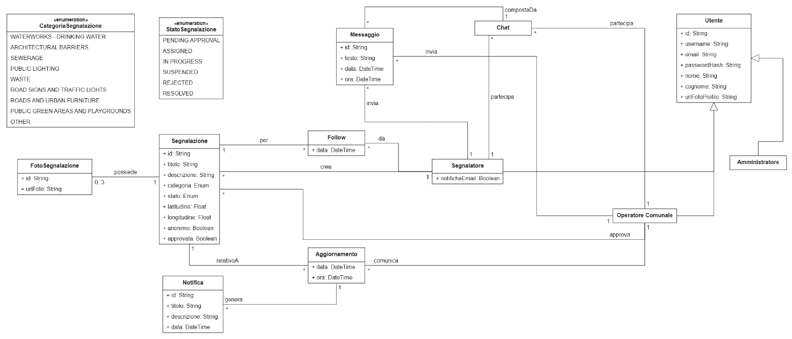
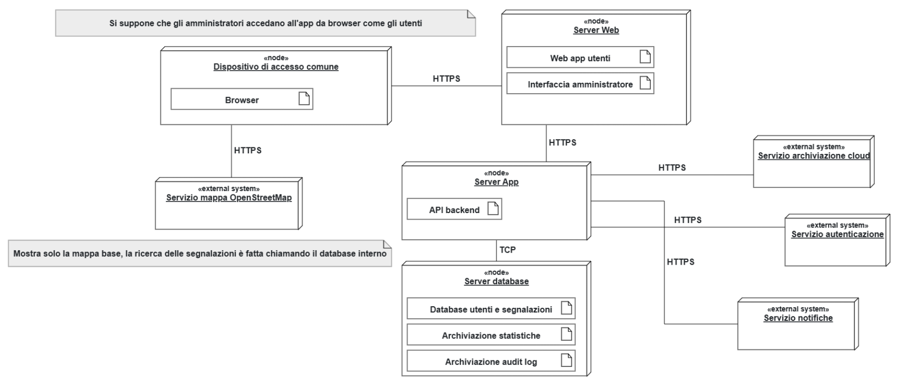

# 1) Glossary / Class Diagram

## Note
- La classe **Visitatore** non è stata aggiunta poichè il visitatore non possiede un profilo registrato sul sistema e interagisce con la piattaforma solamente attraverso operazioni di lettura e non di scrittura, pertanto non ci sono informazioni legate ad esso da archiviare.
- Nella classe **Segnalatore** l'attributo **notificheEmail** è un valore booleano che esprime la volontà o meno di ricevere le notifiche anche via email.
- Nella classe **Segnalazione** l'attributo **approvata** è un valore booleano che esprime l'approvazione o la respinta della segnalazione. Questo è utile per il calcolo delle statistiche sulle segnalazioni.
- La classe legata alle statistiche non è presente in quanto tutte le statistiche (sia pubbliche che private) sono dati calcolati e non sono legati a nessun'altra classe.
- La classe **FotoSegnalazione** contiene gli URL delle foto relative ad ogni segnalazione e permette di esprimere la molteplicità limitata a 3 foto per segnalazione.

---

# 2) Deployment Diagram

