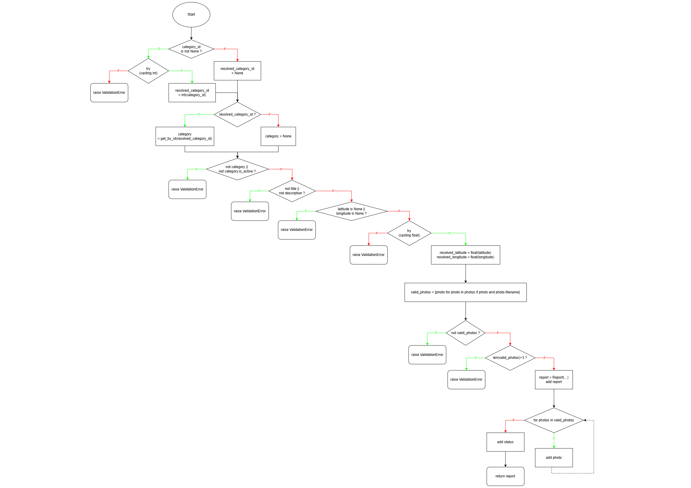
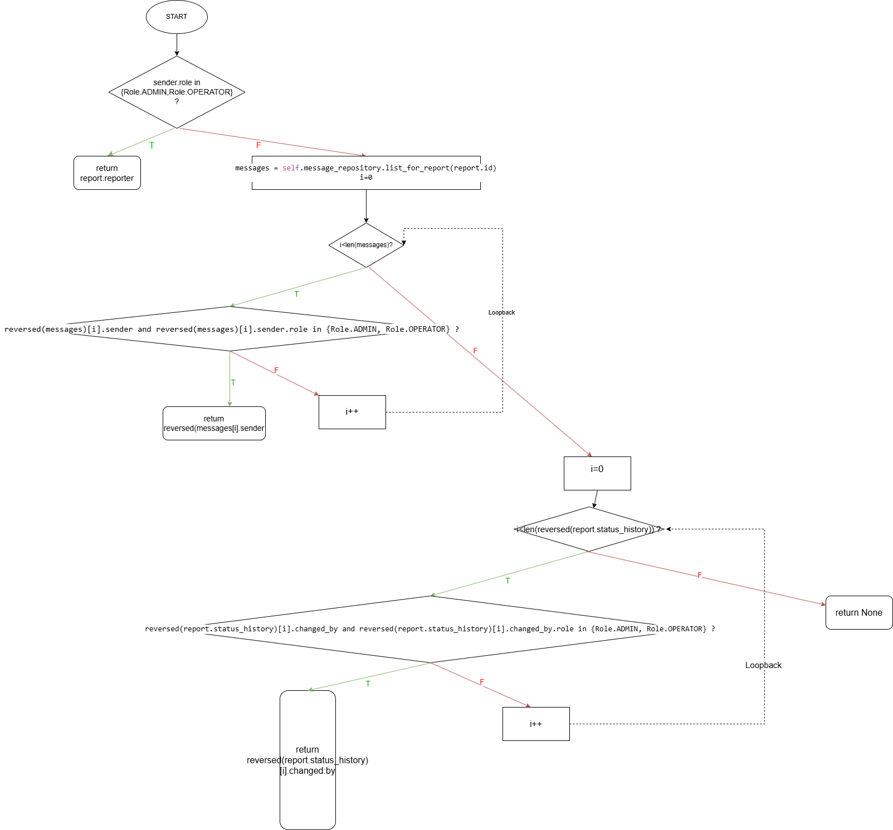
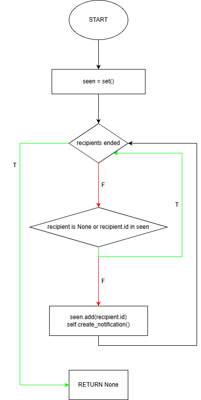
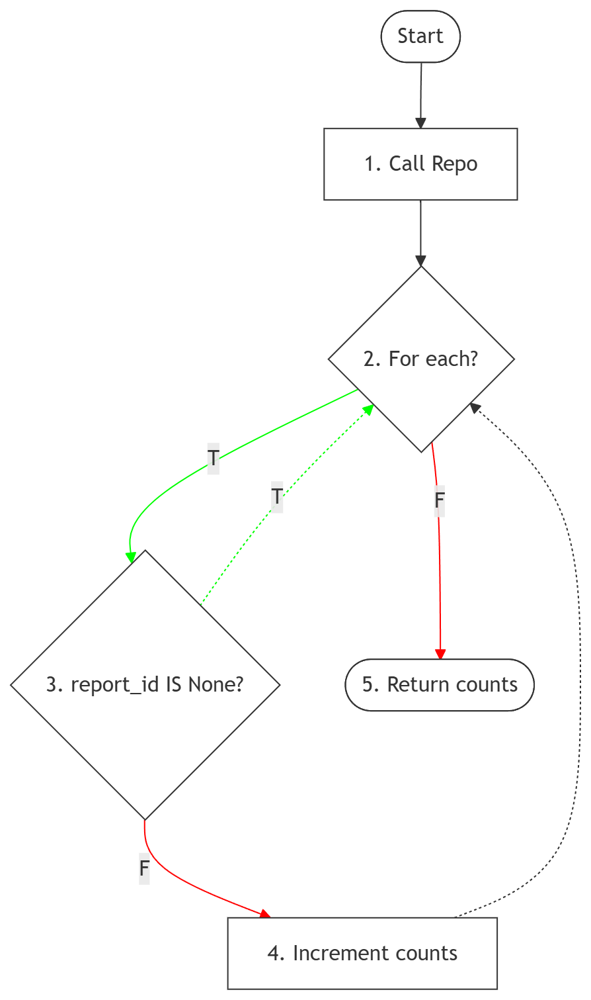
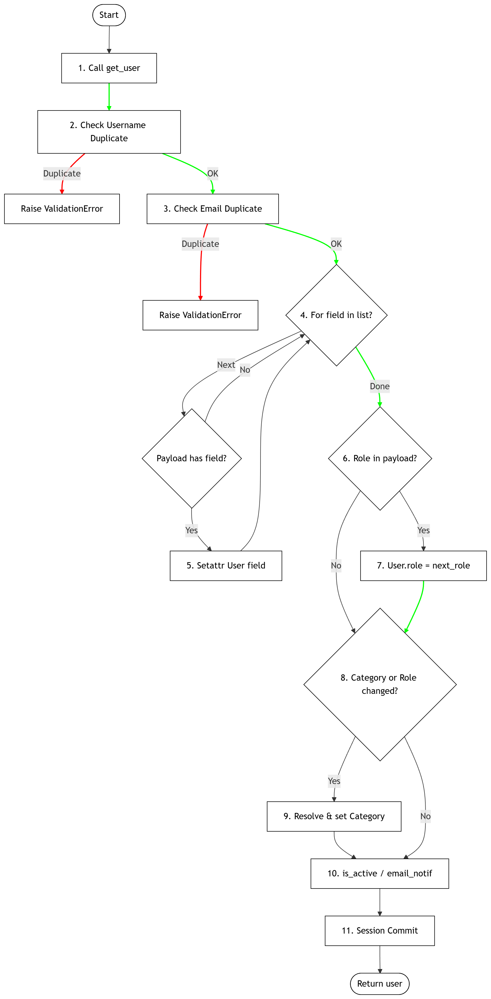

## 1 `ReportService.create_report`

### Control Flow Graph

- 

### Atomic Conditions

* **C1**: `category_id is not None`
* **C2**: `try: int(category_id)  (exception guard)`
* **C3**: `resolved_category_id`
* **C4**: `not category`
* **C5**: `not category.is_active`
* **C6**: `not title`
* **C7**: `not description`
* **C8**: `latitude is None`
* **C9**: `longitude is None`
* **C10**: `try: float(latitude), float(longitude)  (exception guard)`
* **C11**: `not valid_photos`
* **C12**: `len(valid_photos) > 3`
* **C13**: `photo in valid_photos  (loop guard)`

### Structural Lower Bound

Il comportamento della funzione `create_report` dipende dalla validazione dei parametri di input. Il flusso di esecuzione prevede interruzioni nel caso in cui i dati non rispettino le regole di business, più un singolo percorso di successo finale.
Pertanto esistono 8 diversi esiti possibili. Quindi lo structural lower bound è **8**.

### Node Coverage

| ID Test  | Input                                                                                                                   | Covered conditional nodes                                          | Other covered nodes                                                                                                                                                                                                                   | Outcome                                                                  |
|:---------|:------------------------------------------------------------------------------------------------------------------------|:-------------------------------------------------------------------|:--------------------------------------------------------------------------------------------------------------------------------------------------------------------------------------------------------------------------------------|:-------------------------------------------------------------------------|
| **TC-1** | category_id = "abc"                                                                                                     | C1, C2                                                             |                                                                                                                                                                                                                                       | `raise ValidationError("A valid active category is required.")`          |
| **TC-2** | category_id = None                                                                                                      | C1, C3, C4 \|\| C5                                                 | Sono attraversati i nodi `resolved_category_id = None` e `category = None`                                                                                                                                                            | `raise ValidationError("A valid active category is required.")`          |
| **TC-3** | category_id valido e attivo, title = None, description = "abc"                                                          | C1, C2, C3, C4 \|\| C5, C6 \|\| C7                                 | Sono attraversati i nodi `resolved_category_id = int(category_id)` e `category = get_by_id(resolved_category_id)`                                                                                                                     | `raise ValidationError("Title and description are required.")`           |
| **TC-4** | category_id valido e attivo, title valido, description valido, latitude = None, longitude = 10.0                        | C1, C2, C3, C4 \|\| C5, C6 \|\| C7, C8 \|\| C9                     | Segue i nodi attraversati da TC-3 fino al nodo `C6 or C7`                                                                                                                                                                             | `raise ValidationError("Latitude and longitude are required.")`          |
| **TC-5** | category_id valido e attivo, title valido, description valido, latitude = "abc" or longitude = 10.0                     | C1, C2, C3, C4 \|\| C5, C6 \|\| C7, C8 \|\| C9, C10                | Segue i nodi attraversati da TC-4 fino al nodo `C8 or C9`                                                                                                                                                                             | `raise ValidationError("Latitude and longitude must be valid numbers.")` |
| **TC-6** | category_id valido e attivo, title valido, description valido, coordinate valide, photos = []                           | C1, C2, C3, C4 \|\| C5, C6 \|\| C7, C8 \|\| C9, C10, C11           | Segue i nodi attraversati da TC-5 fino al nodo `C10`, sono attraversati i nodi `resolved_latitude = float(latitude) resolved_longitude = float(longitude)` e `valid_photos = [photo for photo in photos if photo and photo.filename]` | `raise ValidationError("At least one photo is required.")`               |
| **TC-7** | category_id valido e attivo, title valido, description valido, coordinate valide, photos = [foto1, foto2, foto3, foto4] | C1, C2, C3, C4 \|\| C5, C6 \|\| C7, C8 \|\| C9, C10, C11, C12      | Segue i nodi attraversati da TC-6 fino al nodo `C11`                                                                                                                                                                                  | `raise ValidationError("A report can contain at most 3 photos.")`        |
| **TC-8** | tutti gli input validi                                                                                                  | C1, C2, C3, C4 \|\| C5, C6 \|\| C7, C8 \|\| C9, C10, C11, C12, C13 | Segue i nodi attraversati da TC-7 fino al nodo `C12`, sono attraversati i nodi `report = Report(...) add report`, `add photo` e `add status`                                                                                          | `return report`                                                          |

### Edge Coverage

La suite di test attraversa tutti i rami del CFG almeno una volta, pertanto fornisce una `edge coverage` del 100%.

### Condition Coverage

Dal momento che sono presenti dei nodi condizionali composti da più condizioni atomiche messe in relazione da operatori `OR`, è necessario includere altri test per raggiungere il 100% del `condition coverage`.
Infatti con la suite di test scelta vengono coperte le condizioni atomiche C1, C2, C3, C4, C6, C8, C10, C11, C12, C13. Pertanto bisogna aggiungere 3 ulteriori test per coprire anche le condizioni atomiche C5, C7, C9.

* **C5**: viene passato in input un `category_id` valido (esistente nel DB), ma che è associato a una categoria con `is_active = False`; in questo modo C4 è falsa (la categoria esiste), ma C5 è vera (è inattiva), facendo scattare l'errore.
* **C7**: passando in input un `title` valido (title != None) ma `description = None`, C6 è falsa mentre C7 è vera e scatta l'errore.
* **C9**: passando in input una `latitude` valida ma `longitude = None`, C8 è falsa mentre C9 è vera e scatta l'errore. 

### Loop Coverage

Per soddisfare pienamente i requisiti della Loop Coverage, la suite di test iniziale progettata per la Node/Edge Coverage non è sufficiente. 

È necessario espandere il Test Case di successo (TC-8) in tre Test Case distinti, mantenendo tutti gli input di base validi ma variando esclusivamente la dimensione dell'array `photos`:
* **TC-8a:** `photos` contenente 1 sola foto valida (Copertura di 1 iterazione).
* **TC-8b:** `photos` contenente 2 foto valide (Copertura di $n$ iterazioni).
* **TC-8c:** `photos` contenente 3 foto valide (Copertura di $nMax$ iterazioni).

### Path Coverage

Ai fini del calcolo dei percorsi, le condizioni composte da operatori logici (es. `not title or not description`) non vengono considerate come un unico blocco. Sfruttando la short-circuit evaluation, si distinguono due percorsi nel CFG: uno in cui il flusso si interrompe alla prima condizione atomica e uno in cui il fallimento avviene sulla seconda, solo dopo aver superato la prima.
Pertanto si identificano 14 percorsi totali:

* **P1**: `category_id` non convertibile in intero.
* **P2**: `category_id` è `None`.
* **P3**: `category_id` valido, ma categoria non presente nel database.
* **P4**: Categoria trovata, ma inattiva (`is_active = False`).
* **P5**: Categoria valida, ma `title` assente.
* **P6**: Titolo valido, ma `description` assente.
* **P7**: Dati testuali validi, ma `latitude` è `None`.
* **P8**: Latitudine valida, ma `longitude` è `None`.
* **P9**: Coordinate presenti ma non convertibili in float.
* **P10**: Nessuna foto valida dopo il filtraggio della lista (lista vuota).
* **P11**: Numero di foto valide superiore al limite massimo di 3.
* **P12**: Input validi, 1 foto.
* **P13**: Input validi, $n$ foto.
* **P14**: Input validi, $nMax$ foto.

### Minimal Suite Test
Per garantire la copertura totale di tutti i criteri analizzati (**Node, Edge, Condition, Loop** e **Path Coverage**), è stata definita una suite di test minimale composta da **14** casi di test. 

| ID Test   | Path    | Test goal                               | Relevant input                      | Outcome           |
|:----------|:--------|:----------------------------------------|:------------------------------------|:------------------|
| **TC-1**  | **P1**  | `category_id` non convertibile in int   | category_id="abc"                   | `ValidationError` |
| **TC-2**  | **P2**  | `category_id` vuoto                     | category_id=None                    | `ValidationError` |
| **TC-3**  | **P3**  | categoria non esistente nel DB          | category_id=-1                      | `ValidationError` |
| **TC-4**  | **P4**  | categoria esistente ma inattiva         | is_active=False                     | `ValidationError` |
| **TC-5**  | **P5**  | `title` vuoto                           | title=None                          | `ValidationError` |
| **TC-6**  | **P6**  | `title` valido, `description` vuoto     | title="titolo", desc=None           | `ValidationError` |
| **TC-7**  | **P7**  | `latitude` vuoto                        | latitude=None                       | `ValidationError` |
| **TC-8**  | **P8**  | `latitude` valido, `longitude` vuoto    | lat=10.0, long=None                 | `ValidationError` |
| **TC-9**  | **P9**  | coordinate non convertibili in float    | latitude="abc"                      | `ValidationError` |
| **TC-10** | **P10** | `valid_photos` vuoto                    | photos=[]                           | `ValidationError` |
| **TC-11** | **P11** | `len(valid_photos)>3`                   | photos=[foto1, foto2, foto3, foto4] | `ValidationError` |
| **TC-12** | **P12** | successo - caso 1 iterazione ciclo      | photos=[foto1]                      | `return Report`   |
| **TC-13** | **P13** | successo - caso $n$ iterazioni ciclo    | photos=[foto1, foto2]               | `return Report`   |
| **TC-14** | **P14** | successo - caso $nMax$ iterazioni ciclo | photos=[foto1, foto2, foto3]        | `return Report`   |

## 2 `MessagingService._resolve_recipient`

### Control Flow Graph

- 

### Atomic Conditions
* **C1**: `sender.role in {Role.ADMIN,Role.OPERATOR}`
* **C2**: `i<len(messages)  (loop guard)`
* **C3**: `reversed(messages)[i].sender`
* **C4**: `reversed(messages)[i].sender.role in {Role.ADMIN, Role.OPERATOR}`
* **C5**: `i<len(reversed(report.status_history))  (loop guard)`
* **C6**: `reversed(report.status_history)[i].changed_by`
* **C7**: `reversed(report.status_history)[i].changed_by.role in {Role.ADMIN,Role.OPERATOR}`

### Structural Lower Bound
Dal momento in cui abbiamo 4 possibili valori di output, abbiamo almeno **4** test case da eseguire.
### Tabella degli input 
| Input ID | Descrizione                                                                                                                                                                                                                                                                                       |
|:---------|:--------------------------------------------------------------------------------------------------------------------------------------------------------------------------------------------------------------------------------------------------------------------------------------------------|
| U1       | Istanza di User con role= Role.OPERATOR                                                                                                                                                                                                                                                           |
| U2       | Istanza di User con role=Role.CITIZEN                                                                                                                                                                                                                                                             |
| R1       | Istanza di Report con status_history contenente un istanza di ReportStatusHistory con il campo changed_by =None e un reporter                                                                                                                                                                     |
| R2       | Istanza di Report con status_history contenente due istanze di ReportStatusHistory, una con il campo changed_by corrispondente ad un User con il campo role in {Role.CITIZEN}, e una il cui campo changed_by corrisponde ad un User con role in {Role.ADMIN, Role.OPERATOR}, e un reporter        |
| MS1      | Istanza di MessagingService, il valore di ritorno del metodo list_for_report del campo message_repository è una lista contenente un messaggio il cui campo sender è uguale a None                                                                                                                 |
| MS2      | Istanza di MessagingService, il valore di ritorno del metodo list_for_report del campo message_repository è una lista con due Messaggi: Messaggio con sender che corrisponde a un user il cui ruolo è CITIZEN  e un messaggio tale che il sender è un user con role in {Role.ADMIN,Role.OPERATOR} |

### Node Coverage
| ID Test | Input (Stato Logico degli Oggetti) | Path (Nodi CFG)                                                                                  | Final Return                                 |
|:--------|:-----------------------------------|:-------------------------------------------------------------------------------------------------|:---------------------------------------------|
| NRR1    | MS1,R1,U1                          | C1, return report.reporter                                                                       | report.reporter                              |
| NRR2    | MS1,R1,U2                          | C1,messages, C2,C3&&C4,i=0,C5,C6&&C7,i++,return None                                             | None                                         |
| NRR3    | MS2,R1,U2                          | C1,messages, C2,C3 && C4,i++,return reverse(messages)[i].sender                                  | reverse(messages)[i].sender                  |
| NRR4    | MS1,R2,U2                          | C1,messages, C2,C3 && C4,i=0,C5,C6 && C7,i++,return reverse(report.status_history)[i].changed_by | reverse(report.status_history)[i].changed_by |

Ogni nodo del CFG è visitato.
### Edge Coverage
I 4 test associati alla Node Coverage riescono a coprire anche tutti gli archi del CFG. 
* **NRR1**:  copre l'arco C1 (T) -> return report.reporter
* **NRR2** : copre gli archi C1(F) -> messages,i=0 -> C2 (F) -> i=0 -> C5 (F) -> return None
* **NRR3** : copre gli archi C1(F) -> messages,i=0 -> C2 (T) -> C3 && C4 (F) -> i++ e viene rieseguito il corpo del loop con C3 && C4 (T) -> return reverse(messages)[i].sender
* **NRR4** : copre gli archi C1(F) -> messages,i=0 -> C2 (F) -> i=0 -> C5 (T) -> C6 && C7 (F) -> i++ e viene rieseguito il corpo del loop con C6 && C7 (T) -> return reversed(report.status_history)[i].changed_by
### Condition Coverage
Non è possibile ottenere la combinazione (F,V) per le condizioni (C3 && C4 ) e (C6 && C7) perchè se l'user è None non è possibile leggere il campo "role".
Per la condition coverage, al fine di riuscire ad ottenere una test suite tale per cui siano testate tutte le possibili combinazioni di ogni singola decisione, è sufficiente la test suite associata alla node coverage. Infatti in quest'ultima vengono testate tutte le possibili combinazioni relative ad ogni decisione.
### Loop Coverage
Per ogni loop consideriamo 3 test: uno che lo faccia entrare nel loop una volta sola, uno che faccia saltare e l altro che ci faccia entrare nel loop almeno 2 o piu volte. Mi garantisce di coprire una parte ragionevole di path senza dover calcolarmi tutti i percorsi uno dopo l altro.
Si nota che i test associati alla node coverage ci consentono di percorrere ogni loop rispettivamente 0 volte (NRR1), 1 volta (NRR2)  e due volte (NRR3,NRR4)
### Path Coverage
Abbiamo due loop, la quantità di iterazioni dipende dalla dimensione dell' input che non sappiamo se sia limitata, per coprire ogni path possibile con ogni numero possibile di iterazioni otterremmo un val. infinito di test. 
Dobbiamo approssimare le nostre capacità reali con la circostanza reale, possiamo accettare la loop coverage (i path dipendono dai loop).
### Minimal Suite Test

| Chiamata alla funzione        | Valore atteso |
|:------------------------------|:--------------|
| MS1._resolve_recipient(R1,U1) | R1.reporter   |
| MS1._resolve_recipient(R1,U2) | None          |
| MS2._resolve_recipient(R1,U2) | reverse(messages)[i].sender              |
| MS1._resolve_recipient(R2,U2) | reverse(report.status_history)[i].changed_by             |

| Criteri   | Min test                                                          |
|:----------|:------------------------------------------------------------------|
| Node      | 4                                                                 |
| Edge      | 4                                                                 |
| Condition | 4                                                                 |
| Path      | ∞ (Approssimati al numero di test necessari per la loop coverage) |
| Loop      | 4                                                                 |

## 3 `NotificationService.notify_status_change`

### Control Flow Graph

 

### Atomic Conditions

* **C1**: `recipients ended ` (loop guard con iteratore)
* **C2a**: `recipient is None`
* **C2b**: `recipient.id in seen` - combinati via `or`

### Structural Lower Bound

Il comportamento della funzione non cambia al variare di report o body, ma dipende solo dai valori nella lista dei destinatari. Esistono solo 2 diversi esiti a seconda il metodo create_notification sia chiamato oppure no. Il lower bound è quindi **2**.

### Node Coverage

| ID Test | recipients | report | body | loop branches | Outcome (call assertion) |
|:--------:|:--------:|:----------:|:-------:|:---:|:---:|
| N1      | []      | R1        | "text" | vuoto | mock create_notification non chiamata |
| N2      | [None, User1]      | R1        | "text" | recipiente nullo / valido  | mock create_notification chimata 1 volta |

### Edge Coverage

I due test precedenti coprono anche il 100% degli edge

### Condition Coverage

Si deve verificare che tutte le condizioni atomiche siano coperte, nel caso in cui si usa short-circuit la condizione recipient.id in seen non è coperta, si aggiunge quindi un test

| ID Test | recipients | report | body | loop branches | Outcome (call assertion) |
|:--------:|:--------:|:----------:|:-------:|:---:|:---:|
| N3      | [None, User1, User1, User2]      | R1        | "text" | rec. nullo / duplicato / valido  |  mock create_notification chiamata 1 volta  |

### Loop Coverage

Manca un test in cui il loop è eseguito solo una volta, si modifica quindi il test N2 

| ID Test | recipients | report | body | loop branches | Outcome (call assertion) |
|:--------:|:--------:|:----------:|:-------:|:---:|:---:|
| N2      | [User1]      | R1        | "text" | recipiente valido  | mock create_notification non chimata |

### Path Coverage

I cammini indipendenti sono infiniti, li si approssima con la loop coverage precedente (coperte 0,1,4 iterazioni)

### Minimal Suite Test

| ID Test | recipients | report | body | loop branches | Outcome (call assertion) |
|:--------:|:--------:|:----------:|:-------:|:---:|:---:|
| N1      | []      | R1        | "text" | vuoto | mock create_notification non chiamata |
| N2      | [User1]      | R1        | "text" | recipiente valido  | mock create_notification chiamata 1 volta |
| N3      | [User1, None, User1, User2]      | R1        | "text" | rec. valido / nullo / duplicato  |  mock create_notification chiamata 2 volte  |

## 4 `NotificationService.count_unread_message_notifications_by_report`

### Control Flow Graph

 

### Atomic Conditions
- **C1**: `notification` in `notifications` (Loop Iteration)
- **C2**: `notification.report_id is None` (Check validation)

### Structural Lower Bound
Esistono 3 cammini linearmente indipendenti necessari per comprendere tutte le possibili decisioni:
- *Cammino1*: Lista vuota (jump del ciclo)
- *Cammino2*: Lista non vuota, ma `report_id` è `None`
- *Cammino3*: Lista non vuota, `report_id` valido

### Node Coverage
| ID Test | user_id | mock return             | loop branches     | Outcome  |
|:-------:|:-------:|:----------------------- |:----------------- |:-------- |
| N1      | 123     | []                      | vuoto             | {}       |
| N2      | 123     | [Notif(report_id=None)] | report_id nullo   | {}       |
| N3      | 123     | [Notif(report_id=10)]   | report_id valido  | {10: 1}  |

### Edge Coverage
Vengono coperti il 100% dei rami.

### Condition Coverage
Ci sono due condizioni che vengono verificate:
- **C1 - Loop**: Torna `True` se è presente una lista di elementi, `False` altrimenti
- **C2 - If**: Torna `True` se il `report_id` è nullo, `False` altrimenti 

### Loop Coverage
- **0 Iterazioni**: Lista notifiche vuota
- **1 Iterazione**: Verifica del corpo del ciclo
- **N Iterazioni**: Verifica dell'accumulo corretto dei conteggi per lo stesso `report_id`

### Path Coverage
- **P1**: `1-2-5` Lista vuota -> Fine
- **P2**: `1-2-3-2-5` Notifica con `report_id` nullo -> Salto -> Fine
- **P3**: `1-2-3-4-2-5` Notifica valida -> Incremento -> Fine

### Minimal Suite Test
- **M1**: `Lista vuota` Copre path 1
- **M2**: `None report_id` Copre path 2
- **M3**: `Valid/Multiple IDs` Copre path 3 

## 5 `UserService.update_user`

### Control Flow Graph

- 

### Atomic Conditions
- **C1**: `username` & `username != user.username` & `repo.get_by_username(username)`
- **C2**: `email` & `email != user.email` & `repo.get_by_email(email)`
- **C3**: `payload.get(field) is not None` 
- **C4**: `payload.get("role") is not None`
- **C5**: `category_id` in `payload` or `payload.get("role") is not None`

### Structural Lower Bound
Lo structural Lower Bound è pari a 6, e ciò è dovuto dal fatto che i molteplici punti decisionali sono indipendenti, che creano differenti cammini possibili attraverso la funzione di aggiornamento.

### Node Coverage
| ID Test | payload             | repo state              | loop branches     | Outcome                      |
|:-------:|:------------------- |:----------------------- |:----------------- |:---------------------------- |
| N1      | {"username": "dup"} | Username already exists | vuoto             | `Validation Error`           |
| N2      | {"email": "dup"}    | Email already exists    | vuoto             | `Validation Error`           |
| N3      | {"first_name": "N"} | Acceptable              | field present     | `Success`(commit)            |
| N3      | {"role": "OP"}      | Acceptable              | vuoto             | `Success`(Role/Cat updated)  |

### Edge Coverage
Vengono coperti tutti i rami decisionali:
1) Fallimento della validazione dell'Username o dell'Email
2) Esecuzione e salto del corpo del ciclo for
3) Inclusione o esclusione dell'aggiornamento del Role e Category
4) Impostazione dei flag finali

### Condition Coverage
Vengono testate le condizioni composte, assicurando che le query avvengano soltanto nel caso in cui il valore nel payload è diverso da quello attuale dell'utente.

### Loop Coverage
Il ciclo sui campi editabili viene testato per:
- **0 iterazioni**: lista fissa
- **N iterazioni**: campi presenti nel payload contro campi assenti

### Path Coverage
- **P1**: `1-2-ErrUsername` Errore di validazione Username
- **P2**: `1-2-3-ErrEmail` Username valido -> Errore di validazione Email
- **P3**: `1-2-3-4-6-8-10-11-End` Username e Email validi -> No campo nel payload -> Nessun cambio ruolo
- **P4**: `1-2-3-4-5-6-8-10-11-End` Aggiornamento dei campi anagrafici standard
- **P5**: `1-2-3-4-5-6-7-8-9-10-11-End` Cammino completo: Aggiornamento dati, cambio ruolo e risoluzione della categoria

### Minimal Suite Test
- **M1**: `Test Username Duplicate` Copre path 1
- **M2**: `Test Email Duplicate` Copre path 2
- **M3**: `Test Basic Update` Copre path 4
- **M4**: `Test Full Role Update` Copre path 5
